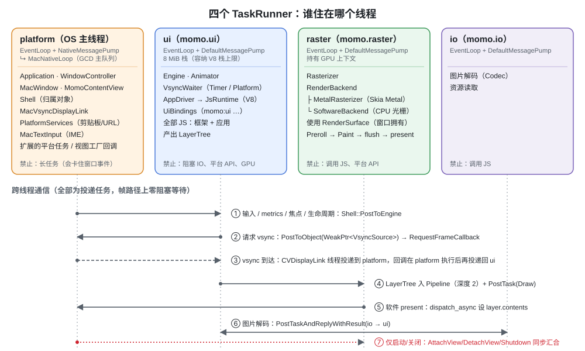
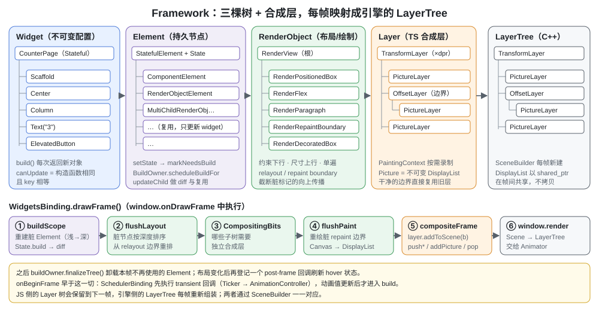
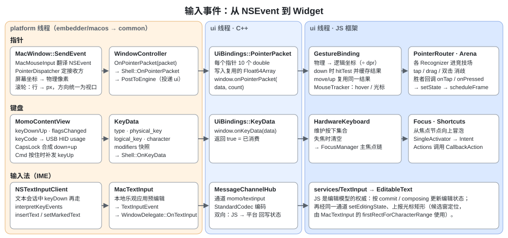

# Momo 架构与运行机制

本文说明 Momo 现在的代码**怎么工作**、**为什么这样设计**：模块划分，以及一个应用从进程启动、出帧、处理输入到退出的完整过程。它是这类信息的唯一来源；其他文档各管一件事：

| 文档 | 内容 |
|---|---|
| [README.md](README.md) | 使用者：构建运行、写应用、打包 |
| [ONBOARDING.md](ONBOARDING.md) | 维护者：规则、阅读路线、常见改动的步骤 |
| [docs/07-extension-system.md](docs/07-extension-system.md) | 原生扩展：怎么写、宿主能力表、SDK、关闭顺序 |
| [docs/09-build-and-deps.md](docs/09-build-and-deps.md) | 构建、依赖、打包、测试、发布 |
| [docs/10-coding-standards.md](docs/10-coding-standards.md) | 编码规范 |
| [docs/11-roadmap.md](docs/11-roadmap.md) | 现状与未做 |

平台相关部分以 **macOS** 为例。Windows 平台层与它同构（§3.13），但**从未在 Windows 上运行验证**。文中的代码块都是**伪代码**：保留真实的类名、函数名和调用顺序，省略错误处理、断言和日志；真实实现以标注的源文件为准。

## 目录

1. [总览](#1-总览)
2. [基础设施 base：对象、事件循环、线程](#2-基础设施-base对象事件循环线程)
3. [Embedder 层](#3-embedder-层)
4. [Engine 层](#4-engine-层)
5. [Framework 层（TypeScript）](#5-framework-层typescript)
6. [端到端：一次点击到屏幕更新](#6-端到端一次点击到屏幕更新)
7. [构建与测试](#7-构建与测试)
8. [移植新平台](#8-移植新平台)

---

## 1. 总览

### 1.1 目标与分层

用 JS/TS 编写 macOS / Windows 桌面应用，UI 完全自绘（Skia），产物是原生可执行程序。分层借鉴 Flutter，不追求与 Flutter API 兼容；不做移动端与 Web。


| 层 | 语言 | 目录 | 一句话职责 |
|---|---|---|---|
| Framework | TypeScript | `framework/packages/momo/src` | View/Element/RenderObject 三棵树、布局、绘制组织、手势、动画、Material 控件;应用(`app`)与原生窗口(`Widget`)对象。运行在引擎内嵌的 V8 中;由运行时自带,应用以 `import "momo:framework"` 使用(§4.6) |
| Engine | C++20 | `engine/` | V8 运行时与 `momo:*` 绑定、帧调度、DisplayList/LayerTree、Skia 光栅化、文本排版、图片解码、原生扩展的宿主能力表 |
| Embedder | C++ / Objective-C++ | `embedder/` | 可执行程序本身：进程入口、原生消息循环、窗口、渲染表面、VSync、输入/IME，并负责装配与驱动 Engine |
| base | C++20 | `base/` | 全项目基础库：`Object`（线程归属 + 延迟析构）、`EventLoop`、`TaskRunner`、`Pipeline`、`Status` |

依赖方向由 CMake 保证（不提供反向链接）：

```
应用 (JS) ── import "momo:framework"、内置扩展 "momo:webview"（运行时自带的 JS 模块）
framework (JS) ── 只通过 import "momo:ui" / "momo:services" 与 engine 交互
embedder ──► engine（含 engine/platform 契约）──► base
   └──────────────────────────────────────────► base
```

**依赖倒置**是整个分层最关键的一点：engine 需要宿主提供的能力（渲染表面、VSync、输入事件……）以**纯虚接口**的形式声明在 `engine/platform/` 里，接口归使用方 engine 所有。embedder 实现这些接口，再把实例注入给 engine。因此：

- engine 不 include 任何 `embedder/` 头文件，可以脱离真实窗口做 headless 测试；
- 移植新平台 = 在 `embedder/<os>/` 实现这组接口，再写一个入口（§8）。

**engine 只认识视图**：一个视图的画面、尺寸与输入。窗口的外观与行为（标题、光标、位置、标题栏、拖动、创建与关闭的询问）、菜单与托盘、剪贴板、打开 URL、输入法都属于宿主——它们不出现在 engine 的任何接口里，而是由 embedder 在引擎的消息通道上注册处理器，JS 与宿主直接往返（§3.10）。这与 Flutter（engine 只有 view，窗口由 embedder/插件经 platform channel 处理）和 Chromium（cc/content 不关心窗口边框，窗口归 `views::Widget` ⇄ `NativeWidget`）的分工一致。新增窗口能力或平台服务只改 embedder 与框架，不改 engine。

JS 与原生之间有三条路，各有分工：

| 通道 | 用于 | 见 |
|---|---|---|
| `momo:ui` 同步绑定 | 高频：绘制记录、场景组装、帧回调、输入事件 | §4.7 |
| 消息通道（异步、面向字节） | 低频：应用与窗口管理、菜单、剪贴板、输入法、平台视图的创建 | §4.8、§3.10 |
| Node-API | 原生扩展（`.node`）；引擎能力另经宿主能力表 | §4.9 |

### 1.2 运行时对象图

一个运行中的 Momo 进程里主要有这些对象（括号内是**归属线程**，即对象只能在这个线程上使用和析构）：

```
main()                                         embedder/macos/main_mac.mm
└─ embedder::Application              (platform)  进程生命周期状态机与退出流程(Quit / Exit);不决定窗口
   ├─ PlatformIntegration (Mac)       (platform)  工厂：窗口、VSync、服务、应用能力(PlatformApp)、菜单与托盘、显示器、原生循环
   │   ├─ MacMouseInput               (platform)  进程内唯一的指针输入:PointerDispatcher + 序列监视器(注入每个 MacWindow)
   │   └─ MacMenus                    (platform)  应用菜单(NSApp.mainMenu)、上下文菜单、托盘图标(MacTray)
   ├─ EventLoop  + NativeMessagePump  (platform)  跑在 [NSApp run] 之上
   ├─ engine::ThreadHost                          创建并 join ui / raster / io 三个线程
   ├─ engine::Shell                   (platform)  引擎实例的协调中枢
   │   ├─ MessageChannelHub           (任意线程)  异步消息通道
   │   ├─ NativeHost                  (platform)  原生扩展的宿主能力表
   │   ├─ ObjectPtr<MacVsyncDisplayLink> (platform)
   │   ├─ Engine                      (ui)
   │   │   ├─ Animator → VsyncWaiter  (ui)        帧调度与背压
   │   │   └─ AppDriver = UiBindings  (ui)        momo:ui / momo:services;拥有 JsRuntime
   │   │       └─ JsRuntime (Node.js 环境: libuv 循环 + V8 Isolate + Context;NodeBindings → uv poll 线程)
   │   └─ Rasterizer                  (raster)
   │       └─ graphics::RenderBackend (MetalRasterizer / 软件;同一 GPU 设备上的视图共用一个)
   ├─ AppChannel / TextInputChannel / PlatformChannels / MenuChannel / TrayChannel   (platform)  宿主通道(§3.10)
   └─ WindowManager                   (platform)  窗口注册表;拥有 WindowChannel(momo/window)。后于 Shell 创建
       └─ 视图 id → WindowController  (platform)  窗口 ⇄ Shell 视图的粘合层(视图 0 = 启动窗口)
           └─ MacWindow               (platform)  MomoWindow/MomoPanel + MomoContentView
               ├─ FallbackSurface(MacMetalSurface + MacSoftwareSurface)   (由 raster 线程使用)
               └─ MacTextInput        (platform)
```

### 1.3 线程模型



与 Flutter 相同的四个 TaskRunner（`engine/common/task_runners.h`）。每个线程都运行同一种 `momo::EventLoop`，区别只在 `MessagePump`（§2.2）。

| Runner | 线程 | 运行内容 | 禁止 |
|---|---|---|---|
| platform | OS 主线程 | 平台 API、窗口与输入回调、宿主通道处理器、扩展的平台任务与视图工厂回调 | 长任务 |
| ui | `momo.ui` | V8/JS 的全部执行、LayerTree 生成、Animator | 阻塞 IO、平台 API、GPU 调用 |
| raster | `momo.raster` | GPU 上下文、DisplayList 重放、present | 调用 JS、平台 API（present 由 surface 实现内部处理） |
| io | `momo.io` | 资源读取、图片解码 | 调用 JS |

规则：

- **V8 只在 ui 线程**。所有 JS 对象都不跨线程，数据以字节或 POD 复制出入。
- **GPU 上下文只在 raster 线程**，**平台 API 只在 platform 线程**。
- 跨线程只靠**投递任务** + **不可变数据**（`DisplayList`、`LayerTree` 以 `shared_ptr` 共享）。帧路径上没有阻塞等待；`PostTaskAndWait` 只出现在关闭与视图解绑的汇合点（`Shell::Shutdown`、`Shell::DetachView`），启动路径不等待。唯一的例外是拖拽缩放时 platform 线程有上限地等一帧（§3.5）。
- **回调一律在调用方线程执行。** A 线程把回调交给某个 API，这个回调就只会在 A 线程上被调用；唯一的例外是注册时以 runner 参数显式指定了执行线程（如 `MessageChannelHub::SetNativeHandler`）。系统线程（CVDisplayLink、DwmFlush、uv poll 线程、inspector IO 线程）和扩展自己的线程只负责投递，从不直接调用别人的回调。
- `RenderSurface` 是唯一被跨线程使用的对象：它归窗口所有（platform），却被 raster 线程使用。所以解绑时 `Shell::DetachView` 必须与 raster 同步汇合，之后窗口才能销毁。

Node.js 另带几类线程，都不执行 JS、不碰 momo 对象：uv poll 线程（`momo.uv.poll`，只等内核事件，§4.6）、libuv 线程池（fs、dns、zlib…，完成后经 uv 循环回到 ui）、Node 平台线程池（V8 后台编译与 GC）、inspector IO 线程（`--dev`）。

---

## 2. 基础设施 base：对象、事件循环、线程

`base/` 是所有 C++ 层的底座（命名空间 `momo`，target `momo_base`），不依赖任何上层。engine 和 embedder 里不出现裸的 `std::thread` / `std::mutex` / `condition_variable`，也不自造弱引用与任务投递，需要时先在 base 中提炼成通用设施。对标 Chromium `base`、Qt Core 的对象与事件循环部分。


### 2.1 Object：线程归属 + 延迟析构

有线程归属的类都继承 `momo::Object`（`base/object.h`），例如 `Application`、`Shell`、`Engine`、`Animator`、`VsyncWaiter`、`Rasterizer`、`MacVsyncDisplayLink`。

| 概念 | 语义 |
|---|---|
| 归属（affinity） | 构造时绑定当前线程的 `EventLoop`（或显式传入 runner）。方法只在归属线程调用，debug 构建由 `MOMO_DCHECK_ON_AFFINITY_THREAD()` 断言 |
| `ObjectPtr<T>` | 独占所有权（`MakeObject<T>()` 创建）；释放时**不立即 delete**，而是 `DeleteLater()`。已被它持有的对象不要再手动 `DeleteLater`；归属线程上需要立即析构时直接用 `unique_ptr` / 成员对象 |
| `DeleteLater()` | 任意线程可调用、幂等；对象在归属线程 EventLoop 的下一个**安全点**析构 |
| `WeakPtr<T>` | 项目内唯一的弱引用；可以随任务到任意线程，只能在归属线程解引用；对象析构或 `InvalidateWeakPtrs()`（"关闭"时）后失效 |
| `PostToObject(weak, fn)` | 投递到对象的归属线程，在那里判活后调用 `fn(*obj)`——判活与调用在同一个任务里，之间不会被析构 |

不用 `shared_ptr` 表达跨线程生命周期。这样做的好处是：析构永远发生在正确的线程，并且对象可以在自己的回调栈里被"删除"（析构推迟到栈展开之后）。

### 2.2 EventLoop 与 MessagePump

`EventLoop`（`base/event_loop.{h,cc}`）负责任务调度和延迟析构，等待/唤醒交给可替换的 `MessagePump`：

| 线程 | pump | 创建者 |
|---|---|---|
| ui / raster / io | `DefaultMessagePump`（条件变量定时等待） | `engine::ThreadHost` → `momo::Thread` |
| platform（OS 主线程） | `NativeMessagePump(platform.native_loop())` | `embedder::Application::Create` |
| 测试 | 不跑 pump，`RunUntilIdle()` 手动驱动 | `testing::ScopedTestEventLoop` |

```cpp
// 伪代码：EventLoop 一轮迭代（base/event_loop.cc）
TimePoint EventLoop::DoWork() {
  // 1. 只取"此刻已到期"任务的快照；执行期间新投递的任务进入下一轮，自我重投的任务不会饿死别人
  auto batch = <此刻已到期的任务>;                 // 按 (到期时间, 投递序号) 排序
  for (auto& task : batch) { ++task_depth_; task(); --task_depth_; }

  // 2. 安全点：栈上没有任务时才析构 DeleteLater 对象。
  //    原生嵌套循环（任务里弹模态框、窗口 live resize）会重入 DoWork，此时 depth > 0，只执行任务不析构
  if (task_depth_ == 0) ProcessDeferredDeletes();

  // 3. 返回下一次唤醒时刻，由 pump 负责等待
  return NextWakeLocked();
}
```

结束语义（`Terminate()`，任意线程、幂等）：在它之前已到期的任务全部执行，其余丢弃（闭包在循环线程析构）；然后**反复清理 DeleteLater 队列直到为空**，保证每个被标记的对象都在本线程析构。循环结束之后再 `DeleteLater`：在循环线程上立即析构，在其他线程上记 ERROR 并泄漏——绝不在错误的线程析构。

每个循环只绑定一个线程，每个线程至多一个循环（`EventLoop::Current()`）；`Run` / `RunUntilIdle` 不可嵌套。

### 2.3 平台主线程：EventLoop 跑在 NSApplication 之上

macOS 的主线程必须由 `[NSApp run]` 驱动，所以 platform 线程的 EventLoop 不能自己阻塞等待，而是把"执行一轮 DoWork"投递成原生任务。`NativeLoop`（接口在 `base/native_loop.h`）由平台实现：

```objc
// 伪代码：MacNativeLoop（embedder/macos/mac_native_loop.mm）
void PostTask(Closure task)         { dispatch_async(dispatch_get_main_queue(), ^{ task(); }); }
void PostDelayedTask(Closure t, d)  { dispatch_after(now + d, dispatch_get_main_queue(), ^{ t(); }); }
bool RunsTasksOnCurrentThread()     { return pthread_main_np(); }
void Run()                          { [NSApp run]; }
void Quit() {
  [NSApp stop:nil];
  [NSApp postEvent:<空的 ApplicationDefined 事件> atStart:NO];   // stop 要等处理完下一个事件才生效
}
```

```cpp
// 伪代码：NativeMessagePump（base/native_message_pump.cc）
void ScheduleWork() { native_.PostTask([state] { RunDoWork(state); }); }

void RunDoWork(state) {
  TimePoint next = state->delegate->DoWork();          // delegate 即 EventLoop
  if (next == TimePoint::max()) return;                // 没有待办
  if (next <= now) native_.PostTask(RunDoWork);        // 还有已到期任务：再投一轮
  else ScheduleDelayed(next);                          // 只保留最早的一次在途 dispatch_after
}
```

GCD 主队列由主 CFRunLoop 在 common modes 下服务，所以窗口拖拽缩放（live resize）和模态对话框期间，platform 线程上的任务照常执行。live resize 时主线程还会在 `setFrameSize:` 里同步等待一帧新尺寸的内容（§3.5），等待期间用 `EventLoop::RunDueTasksNested()` 执行平台任务——它和原生嵌套循环一样只执行任务、不析构。

### 2.4 其他设施

| 设施 | 文件 | 用途 |
|---|---|---|
| `Thread` | `base/thread.h` | 具名线程，自带 EventLoop；默认 8 MiB 栈（macOS 次线程默认 512 KiB，容不下 V8 的栈上限） |
| `Pipeline<T>` | `base/pipeline.h` | 固定深度生产/消费管道，实现帧背压（§4.3） |
| `PostTaskAndWait` / `PostTaskAndReplyWithResult` | `base/task_util.h` | 关闭与解绑的汇合点（目标线程已结束时返回 false，不死锁）；"在 A 线程做事、回 B 线程汇报" |
| `WaitableEvent` | `base/waitable_event.h` | `PostTaskAndWait` 的实现 |
| `Mutex` / `MutexLock`、`BlockingQueue<T>` | `base/lock.h`、`base/blocking_queue.h` | 小临界区保护共享表；EventLoop 服务不到的场景（线程被同步阻塞时仍要收消息，如 `PresentQueue`） |
| `QueueNativeLoop` | `base/queue_native_loop.h` | 不依赖系统消息循环的 `NativeLoop`：headless 宿主与测试的 mock 平台用（`testing::MockNativeLoop` 是它加计数） |
| `Status` / `StatusOr<T>` | `base/status.h` | 全项目禁用异常，可失败操作返回 `StatusOr` |

---

## 3. Embedder 层

Embedder 是**可执行程序本身**：拥有进程入口与原生消息循环，实现 engine 声明的平台契约，装配并驱动 engine。它是唯一认识平台具体实现的层。本章以 macOS 为例，Windows 见 §3.13。

### 3.1 模块划分

| 目录 | 内容 | 能否单测 |
|---|---|---|
| `embedder/common/` | 平台无关的装配逻辑：`Application`（生命周期状态机、有序关闭）、`WindowManager`（窗口注册表）、`WindowController`（窗口 ⇄ Shell）、`AppConfig`（命令行）、宿主通道（`*_channel.*`，§3.10）、`PointerDispatcher`（§3.12）；两个平台共用的 surface 逻辑 `FallbackSurface`、`PresentQueue`（§3.5）与按键编码规则 `key_codes.h`（§3.4）；embedder 自己的平台抽象（见下） | 能，用 `common/testing/mock_platform.h` |
| `embedder/macos/` | Cocoa 实现与入口，见下表 | `momo_embedder_macos_unittests` |
| `embedder/windows/` | Win32 实现与入口（§3.13）；不依赖 `<windows.h>` 的纯逻辑单独成库 `momo_embedder_windows_portable` | 纯逻辑部分在所有平台单测 |
| `embedder/headless/` | `momo_headless`：无窗口宿主。和 macOS / Windows 一样是一个 `PlatformIntegration`（`HeadlessPlatform`：窗口是一块离屏缓冲，原生循环是 `QueueNativeLoop`），跑在同一个 `Application` 上，所以框架测试在这里经过的是真实的启动/关闭流程与全部宿主通道 | 经它运行框架测试 |

两组接口要分清：

- **engine 的平台契约**（`engine/platform/`，`momo::engine::platform`；embedder 内写作 `platform::X`）：`RenderSurface`、`VsyncSource`、`PointerData`/`KeyData`、`ViewportMetrics`、`ViewId`、平台视图的合成布局。engine 只认识这些。头文件零平台 include、零三方依赖，只依赖 base。
- **embedder 的平台抽象**（`embedder/common/`）：`PlatformIntegration`（工厂：窗口、应用唯一的 `VsyncSource`、服务、显示器、原生循环）、`PlatformWindow` + `WindowDelegate`、`PlatformApp`、`PlatformServices`、`PlatformMenus` / `PlatformTray`、`TextInputConnection`、窗口类型（`SystemCursor`、`WindowOptions`、`TitleBarOptions`…）。只有 embedder 使用，engine 看不到。它的作用是让 `embedder/common` 本身也平台无关、可 mock，并让窗口与平台服务的能力只在 embedder 里扩展。

平台实现库（`momo_embedder_macos` / `momo_embedder_windows`）只链接 `momo_engine_platform`（接口）与系统 SDK，不链接引擎库；入口文件只做翻译，业务顺序全部在 `common/`。

macOS 实现（`embedder/macos/`）：

| 文件 | 实现的接口 | 要点 |
|---|---|---|
| `main_mac.mm` | — | 进程入口，只做翻译 |
| `mac_app_delegate.mm` | `NSApplicationDelegate` | 退出拦截、隐藏/显示/激活 → `Application` |
| `mac_menu.mm` / `mac_tray.mm` | `PlatformMenus`、`PlatformTray` | `MenuModel` → `NSMenu`（应用菜单原地更新、上下文菜单）；role = AppKit 标准 action；`NSStatusItem` 托盘（§3.11） |
| `mac_platform_integration.mm` | `PlatformIntegration`、`PlatformApp`、`PlatformServices` | 工厂；应用隐藏/激活（NSApp）；剪贴板（NSPasteboard）、打开 URL（NSWorkspace）；`NSScreen` → `DisplayInfo`（主屏左上原点）；持有进程内唯一的 `MacMouseInput` 并注入每个窗口 |
| `mac_native_loop.mm` | `NativeLoop` | GCD 主队列 + `[NSApp run]` / `[NSApp stop:]`（§2.3） |
| `mac_window.mm` | `PlatformWindow`、`PointerWindow` | `MomoWindow`（NSWindow）/ `MomoPanel`（NSPanel，非激活面板）只把 `-sendEvent:` 转给 `MacWindow::SendEvent`；`MomoContentView`（自定义 `NSView`，first responder，键盘、`NSTextInputClient`、光标）；隐藏标题栏、系统拖动、移动循环、指针捕获等窗口操作 |
| `mac_mouse_events.mm` | — | `MacMouseInput`：持有 `PointerDispatcher`，`NSEvent` → `PointerInput`；进程级本地监视器接住序列期间不属于任何 momo 窗口的事件 |
| `mac_platform_views.mm` / `mac_platform_view_input.mm` | — | 平台视图宿主（几何）/ 平台视图的输入投递（§4.10） |
| `mac_surface_metal.mm` / `mac_surface_software.mm` | `RenderSurface` | `CAMetalLayer` / IOSurface（§3.5） |
| `mac_vsync_displaylink.mm` | `VsyncSource` | `CVDisplayLink`，按需启停（§3.6） |
| `mac_text_input.mm` | `TextInputConnection` | IME 状态与 `NSTextInputClient` 的同步查询（§3.7） |
| `mac_key_mapping.mm` | — | 键盘事件 → `KeyData`：keyCode → USB HID usage 表、修饰键（`flagsChanged`） |

### 3.2 启动流程


```objc
// 伪代码：进程入口（embedder/macos/main_mac.mm）
int main(argc, argv) {
  config   = AppConfig::Parse(args);                    // [<app>] --title --width --height --dev --inspect-port --inspect-brk
                                                        // --no-startup-window;未知选项与 -psn_* 等系统参数忽略
  platform = macos::CreateMacPlatformIntegration();     // [NSApplication sharedApplication]，ActivationPolicyRegular，
                                                        // 默认的应用菜单(MacMenus: 隐藏、退出)
  NSApp.delegate = [MacAppDelegate new];

  app = Application::Create({config, resources_dir = NSBundle.mainBundle.resourcePath}, platform);
  delegate.application = app;
  exit_code = app->Launch().ok() ? app->Run() : 1;      // Launch 不等 bundle 执行；Run() 内部就是 [NSApp run]
  return exit_code;                                      // 正常从 main 返回，不让 AppKit 直接 exit()
}
```

```cpp
// 伪代码：装配（embedder/common/application.cc）
Application::Create(options, platform) {
  require(platform->native_loop().RunsTasksOnCurrentThread());     // 必须在 OS 主线程
  loop = EventLoop::Create(make_unique<NativeMessagePump>(platform->native_loop()));
  loop->BindToCurrentThread();      // 之后主线程上创建的 Object 都归属它
  thread_host_  = ThreadHost("momo");                              // 起 momo.ui / momo.raster / momo.io
  task_runners_ = thread_host_->MakeTaskRunners(loop->GetTaskRunner());
}

Application::Launch() {
  TransitionTo(kLaunching);
  CreateEngine();                   // Shell::Create + 宿主通道 + WindowManager: 只组装, 不等待其他线程, 没有 JS
  // 启动窗口(隐式视图 0;--no-startup-window 时不建): 创建即绑定为引擎的视图并显示(此时只有闪屏底色)
  if (config.startup_window) window_manager_->OpenStartupWindow();
  shell_->Run([](Status s) { OnRuntimeStarted(s); });   // 异步: ui 线程执行 bundle, 主线程回到事件循环
}

Application::OnRuntimeStarted(status) {   // Shell::Run 的结果, platform 线程
  if (!status.ok()) return Exit(1);       // bundle 加载/执行失败: 走退出流程, 退出码 1
  TransitionTo(kRunning);
}

Application::CreateEngine() {
  settings = { 入口/assets 路径 ← engine::LocateApp(命令行的 <app> 或 <resources>/app),
               dev_mode, inspector,
               builtin_dir = <resources>/builtin（运行时自带的 JS 模块: 框架、内置扩展）,
               code_cache_dir = <入口给出的应用缓存目录>/v8（非 --dev）,
               refresh_rate = 主显示器刷新率（vsync 回退定时器用） };
  shell_ = Shell::Create(task_runners_, settings,
      on_exit_requested = [](int code) { Exit(code); });   // JS process.exit(code), 见 §3.8
  // 宿主通道先于 JS 就位(bundle 顶层代码就可能设置标题、打开窗口、退出)
  app_channel_        = AppChannel(shell_->hub(), platform runner, host = this);                // momo/app
  text_input_channel_ = TextInputChannel(shell_->hub(), ..., WindowManager::FocusedTextInput);  // momo/textinput
  platform_channels_  = PlatformChannels(shell_->hub(), ..., platform->services());             // momo/clipboard、momo/url
  menu_channel_       = MenuChannel(shell_->hub(), platform runner, platform->menus(), host = this);  // momo/menu
  tray_channel_       = TrayChannel(shell_->hub(), platform runner, platform->menus());               // momo/tray
  // 窗口注册表: 拥有 momo/window;应用唯一的 VsyncSource: CreateVsyncSource → Shell::SetVsyncSource。
  // 之后每个窗口创建即 Shell::AttachView + 发送 metrics/可见性。
  window_manager_ = WindowManager(platform, config.window, observer = this, *shell_, *text_input_channel_);
  if (options.on_engine_created) options.on_engine_created(*shell_);   // 入口注册自己的通道(momo_headless 的 momo/test)
}
```

"合适的时机创建 JS 环境"在实现中的含义：先组装引擎（`Shell::Create` 只创建对象、投递任务，不等待），窗口随即创建并 `Show()`（用户立刻看到原生窗口和闪屏底色），然后才启动 JS 运行时；引擎先于窗口，所以不存在"有窗口、没有引擎"的状态。V8 初始化与 bundle 执行在 ui 线程进行，Rasterizer 初始化在 raster 线程**并行**进行，主线程不等它们——`Launch()` 返回后就进入消息循环（窗口可响应，`--inspect-brk` 等待调试器时也不卡主线程）。

应用的定位（`engine::LocateApp`，`engine/common/app_layout.h`）：应用路径是一个目录（入口是其 `package.json` 的 `main`）或一个 JS 文件，命令行的第一个位置参数给出，缺省是应用包内的 `<resources>/app`——打包后的应用与开发时走同一条路（规则见 docs/09 §4.2）。应用旁边的 `<resources>/builtin/` 是运行时自带的 JS 模块（§4.6），应用的文件里没有它们。

### 3.3 生命周期

```
NotRunning → Launching → Running ⇄ Suspended → Terminating
   │            └────(启动失败)─────────────────────┘
   └──(未 Launch 即销毁)───────────────────────────┘
```

- **生命周期属于应用, 与窗口无关**。Suspended 只表示应用整体被隐藏（`applicationDidHide`）；没有窗口也是合法状态（JS、定时器、网络照常运行，只是不出帧）。最后一个窗口关闭不退出应用，只发 `momo/app windowAllClosed`，由 JS 决定（`app.quit()`）。
- 状态每次变化：(1) `Shell::SetAppSuspended`——引擎只需要知道是否出帧；(2) 经 `momo/app stateChanged` 通知 JS（框架的 `app.state` / `'state-changed'`）。应用的前台状态（`applicationDidBecomeActive/ResignActive`）经 `activeChanged`，点击 Dock 图标（`applicationShouldHandleReopen`）经 `activate`。
- **窗口可见性按视图**：窗口的显示/隐藏、最小化由 `WindowDelegate::OnWindowStateChanged` 上报，`WindowController` 把"可见 = 已显示且未最小化"交给 `Shell::OnViewVisibilityChanged`。引擎丢弃不可见视图的画面；只有应用挂起或没有可见视图时才停 Animator（重新可见时补一帧）。以 `show: false` 创建、尚未显示的窗口照常出帧：第一帧呈现后宿主发 `readyToShow`。

### 3.4 窗口与输入归一化

`MacWindow` 创建 `NSWindow` 和内容视图 `MomoContentView`。视图是 layer-backed 的、不透明、接受 first responder，并实现 `NSTextInputClient`。视图持有指向 `MacWindow` 的**非拥有**指针，`MacWindow` 析构时先调用 `[view detachOwner]` 清空它，之后到来的 AppKit 回调直接忽略。

键盘事件在 platform 线程归一化为平台无关的 `engine/platform/input_types.h` 类型，经 `WindowDelegate`（即 `WindowController`）转给 `Shell`。指针事件多一步：谁接收由进程内唯一的 `PointerDispatcher`（`embedder/common/pointer_dispatcher.h`，平台无关）决定——平台层只**翻译**原生事件、**执行**投递（中介者），按下序列、悬停、滚动锁定这些状态只在派发器里有一份（§3.12）：

```objc
// 伪代码：指针事件（embedder/macos/mac_window.mm、mac_mouse_events.mm）
void MacWindow::SendEvent(NSEvent* e, super) {         // MomoWindow / MomoPanel -sendEvent: 调用
  if (窗口装饰的按下序列) return super(e);                // 红绿灯、边缘缩放区的按下归 AppKit
  mouse_.Dispatch(e, this);                            // MacMouseInput：翻译为 PointerInput（类型、屏幕坐标、按键、
  ForwardToWindowChrome(e);                            // 滚动位移…；不做决定）→ PointerDispatcher 决定接收方
}                                                      // 装饰的跟踪区照常记账：进入/离开由输入流推导（红绿灯悬停）

// MacWindow 作为 PointerWindow 执行：
void MacWindow::SendToMomo(PointerDataPacket packet, const PointerInput&) {
  for (PointerData& d : packet) {                      // 屏幕坐标 → 本视图物理像素（左上原点）；滚动 点 → 像素
    NSPoint p = [view_ viewPointFromScreen:{d.screen_x, d.screen_y}];
    d.physical_x = p.x * scale; d.physical_y = (height - p.y) * scale;
  }
  delegate_->OnPointerPacket(packet);                  // → WindowController → Shell::OnPointerPacket → 投递 ui
}
void MacWindow::SendToPlatformView(int64_t view, const PointerInput& in, PointerPhase phase) {
  [input_router_ deliverEvent:(NSEvent*)in.native toPlatformView:view phase:phase ...];  // 经 AppKit 投递
}
```

滚动位移统一成"视口滚动方向"（AppKit 给的是内容移动方向），保留惯性阶段标记；普通滚轮按行换算为点。

键盘事件由 `mac_key_mapping` 翻译为 `KeyData{type, physical_key（USB HID usage）, logical_key, character, modifiers}`。编码规则（`physical_key = 0x00070000 | usage`；可打印键的 `logical_key` 是当前布局下不带修饰键的字符的码点，特殊键是 `kSpecialKeyBase + usage`；哪些键算特殊键）是框架可见的契约，只在 `embedder/common/key_codes.h` 定义一次，平台层只留"原生键码 → HID usage"的表。文本输入不走 `KeyData`，走 IME（§3.7）。几个 AppKit 特性要专门处理：

- 修饰键只有 `flagsChanged`，按下/抬起由修饰位判断；CapsLock 每次切换只有一个事件，合成一次完整的 down + up。
- 按住 Command 时，`-[NSApplication sendEvent:]` 会吞掉 `keyUp`，窗口和 first responder 都收不到。用 `NSEvent` 本地监视器补发，与 Flutter macOS embedder 的做法相同（子类化 `NSApplication` 也能解决，但要改 `NSPrincipalClass`，更侵入）。`keyUp:` 按 `NSEvent` 对象去重，万一 AppKit 也正常投递，只处理一次。
- 文本输入会话打开时，`keyDown` 在发出 `KeyData` 之后**再**交给 `interpretKeyEvents`（输入法）。同一按键是快捷键还是字符，由框架层判断。

窗口侧的变化由 `MomoWindowObserver`（`NSWindowDelegate`）上报：`windowDidResize` / `windowDidChangeBackingProperties` / `windowDidChangeScreen` → `OnMetricsChanged`；`windowDidBecomeKey` / `ResignKey` → 焦点；显示/隐藏、最小化、缩放、全屏 → `OnWindowStateChanged`；`windowShouldClose` → `OnCloseRequested`。

`WindowController`（`embedder/common/window_controller.h`）是窗口与 Shell 视图之间很薄的一层，创建即绑定引擎（`Create` 里 `Shell::AttachView` 并发送当前的 metrics 与可见性），事件的去向在创建时经 `Bindings` 注入：

- 视图相关的事件（尺寸、指针、按键、可见性）→ `Shell`；
- 纯通知类的窗口事件（状态、焦点、屏幕框、窗口控制按钮占用区域、首帧）→ `WindowChannel`，输入法事件 → `TextInputChannel`，都直接发给 JS。**窗口的系统焦点不经引擎**；
- 关闭请求需要有人做决定 → `close_requested` 回调，即 `WindowManager::RequestCloseWindow`：原生关闭总是先被拦截，异步询问 JS（§3.10）。

平台窗口上报的是原始值，"与上次相同则不转发"的去重只在这里做一次。窗口外观与行为的请求（标题、光标、位置…）不经过它：`momo/window` 通道直接调用 `PlatformWindow`。

### 3.5 渲染表面


`RenderSurface`（`engine/platform/render_surface.h`）只有一个核心方法：在 raster 线程上 `AcquireFrame(physical_size)`，返回本帧的 `SurfaceFrame`（像素缓冲或 GPU 目标，外加一个 `present` 闭包）。

**Metal 路径（默认）**：`MacMetalSurface` 在内容视图最底层加一个专用子视图 `MomoSurfaceBaseView`，`CAMetalLayer`（BGRA8Unorm、sRGB、`framebufferOnly = NO`、最多 3 个 drawable）挂在它的 layer 上；平台视图宿主是其后加入的子视图，层级只由子视图顺序决定。下面是普通帧的路径；平台视图合成帧与拖拽缩放期间的帧改经主线程呈现队列，与平台视图几何、新窗口尺寸在同一个 `CATransaction` 里生效（见本节末尾与 §4.10）。

```objc
// 伪代码：raster 线程（embedder/macos/mac_surface_metal.mm）
StatusOr<SurfaceFrame> AcquireFrame(Size size) {
  if (software_) return software_surface_.AcquireFrame(size);       // 已回退
  if (layer_.drawableSize != size) {
    [CATransaction begin]; [CATransaction setDisableActions:YES];   // raster 线程没有 run loop：显式事务
    layer_.drawableSize = size;
    [CATransaction commit];
  }
  drawable = [layer_ nextDrawable];
  if (!drawable) return Unavailable;                                 // 本帧丢弃，不阻塞
  return { kMetal, gpu_target = drawable,
           present = [queue, drawable] {
             buf = [queue commandBuffer];                            // 与 Skia 的绘制命令同一个 queue，排在其后
             [buf presentDrawable:drawable]; [buf commit];
           } };
}
```

drawable 尺寸以 raster 线程本帧请求的尺寸为准，所以 resize 时不需要跨线程同步 `drawableSize`。主线程只在 `setFrameSize` / backing 变化时更新图层的 `frame` 和 `contentsScale`。

**软件路径（回退）**：`MacSoftwareSurface` 在 raster 线程直接把像素画进 IOSurface（零拷贝），由主线程设为 `layer.contents`。为了让主队列和内存有界，主线程最多挂起一帧：

```objc
// 伪代码（embedder/macos/mac_surface_software.mm）
AcquireFrame(size):                       // raster
  buf = PickBuffer(size)                  // 最多 3 个；跳过 pending、displayed 以及 IOSurfaceIsInUse 的
  if (!buf) return Unavailable            // 全忙：丢帧
  IOSurfaceLock(buf); return { kSoftware, pixels = base address, present = Present(buf) }

Present(buf):                             // raster
  IOSurfaceUnlock(buf)
  lock { if (pending) release(pending);   // 主线程还没显示的旧帧直接丢弃
         pending = retain(buf);
         schedule = !dispatch_scheduled; dispatch_scheduled = true; }
  if (schedule) dispatch_async(main, DisplayPending)     // 槽从空变满才投递一次

DisplayPending():                         // main
  surface = take(pending); layer.contents = surface; displayed = surface
```

**选择与回退**：

1. 平台集成启动时创建一次应用级的 Metal 设备与命令队列（`MacMetalDevice`），交给之后的每个窗口；环境变量 `MOMO_SOFTWARE_RENDERING=1` 或没有 Metal 设备 → 不创建，窗口直接用软件 surface。有设备时窗口的 surface 是 `FallbackSurface`（`embedder/common`）：Metal surface + 软件 surface 的组合。
2. raster 线程 `Rasterizer::Setup` 时：按 `surface.kind()` 创建后端；Metal 后端建不出来（例如 `GrDirectContext` 创建失败）→ 调 `surface.FallBackToSoftware()`：`FallbackSurface` 停用 Metal surface（`Deactivate`：主线程移除 `CAMetalLayer`），`kind()` 变为 `kSoftware`，之后的 `AcquireFrame` 转给软件 surface → Rasterizer 换用软件后端。回退逻辑只在 `FallbackSurface` 里有一份，Windows 的 D3D surface 用的是同一个类（设备丢失经 `GpuSurface::device_lost()` 报告，同样由它回退；Rasterizer 在下一帧发现 `surface.kind()` 与后端不一致时换后端。重建 GPU 设备没有实现）。
3. 全部窗口的 surface 报告同一个设备与队列，Rasterizer 据此让它们共用一个后端：整个应用一份 `GrDirectContext`（一份着色器/字形/纹理缓存）。

**拖拽缩放同步**（`PresentQueue`，`embedder/common/present_queue.h`；同 Flutter 的 `FlutterResizeSynchronizer`）。窗口尺寸在主线程的系统回调里变化，帧却是 raster 线程异步呈现的——不同步的话，新尺寸的窗口里是被 `contentsGravity` 拉伸的旧帧，直到松手。`PresentQueue` 是每个窗口一个的"raster 产出的帧与 platform 线程的同步点"，两个平台、四种 surface 共用：必须在 platform 线程完成的呈现入队（`Post`），在 raster 线程完成的呈现只登记（`NotePresented`）。窗口在尺寸变化的回调里调用 `SynchronizeResize(size, notify_metrics)`：把新尺寸交给引擎，然后就地等到这个尺寸的帧呈现，回调返回后系统才显示新尺寸，窗口与内容（以及平台视图几何）同时变化。等待期间以 `EventLoop::RunDueTasksNested` 执行平台任务（vsync 的请求与回调都要经过主线程，否则死锁）；上限 100 ms（`kLiveResizeFrameWait`），应用更慢时退化为暂时拉伸，不让窗口拖动卡住。

### 3.6 VSync：按需启停的 CVDisplayLink

`VsyncSource::RequestFrameCallback(cb)` 是**一次性**请求：只在框架真正要出帧时请求，没有动画就不请求，空闲时 CVDisplayLink 也会停下（零功耗）。

按项目的回调规则（§1.3），`cb` 必须在调用方线程上执行，也就是 platform 线程。CVDisplayLink 自己的线程**从不调用 `cb`**，只记下帧时间并投递一次通知：

```cpp
// 伪代码（embedder/macos/mac_vsync_displaylink.mm）
// platform 线程
void RequestFrameCallback(Callback cb) {
  callback_ = cb;                                // 只在 platform 线程访问；新请求覆盖旧请求
  if (!running_) { CVDisplayLinkStart(link_); running_ = true; }
}

// CVDisplayLink 自己的高优先级线程：只投递，不回调
static CVReturn OnDisplayLink(..., now, output_time, ctx) {
  lock {
    if (destroyed) return;
    frame_start = HostTimeToTimePoint(now); frame_target = HostTimeToTimePoint(output_time);
    if (!tick_posted) { tick_posted = true; PostToObject(owner, &OnTick); }   // 合并多余的 tick
  }
}

// platform 线程
void OnTick() {
  lock { tick_posted = false; start, target = frame_start, frame_target; }
  if (!callback_) {                              // 空闲 tick：停掉 link（请求与停止都在本线程，无竞态）
    if (running_) { CVDisplayLinkStop(link_); running_ = false; }
    return;
  }
  cb = take(callback_);
  cb(start, target);                             // 在调用方线程执行
}
```

整个应用只有一个 `MacVsyncDisplayLink`（所有窗口共用一个 Animator）。它跟随 id 最小的窗口所在的显示器（视图 0 优先；`WindowManager` 在窗口打开/关闭时经 `PlatformIntegration::SetVsyncWindow` 重新指定，没有窗口时用主显示器）；这个窗口移到另一块屏幕（`NSWindowDidChangeScreenNotification`）时，`UpdateDisplay()` 切换 link 绑定的显示器。`MacVsyncDisplayLink` 是 platform 线程归属的 `Object`，由 `Shell` 以 `ObjectPtr` 持有，ui 线程只拿 `WeakPtr`（§4.3）。析构时先在锁内置 `destroyed`，再 `CVDisplayLinkStop`（它会等待在途回调返回）；已投递未执行的 `OnTick` 因 `WeakPtr` 失效而作废，所以析构后不会再有回调。Windows 的 `WinVsyncDwm` 用同样的模型（`DwmFlush` 线程只投递）。

### 3.7 IME

`MomoContentView` 实现 `NSTextInputClient`，把每个调用转给 `MacTextInput`（`TextInputConnection` 的实现）：

- **JS 是编辑模型的权威**：JS 经 `momo/textinput` 通道下发 `SetEditingState`（文本、选区、composing 区间，UTF-16 下标），覆盖本地状态。
- 两次同步之间，输入法事件先在本地**乐观应用**，保证 `hasMarkedText` / `markedRange` / `selectedRange` 这些同步查询立即反映最新的预编辑；同时翻译成 `TextInputEvent`（commit / composing 等），经 `WindowDelegate::OnTextInput` → `WindowController` → `TextInputChannel` 走 `momo/textinput` 通道发给 JS（不经过 Shell）。
- JS 上报的光标矩形（物理像素，相对内容区）用于 `firstRectForCharacterRange`，决定候选窗位置。

### 3.8 退出与有序关闭

退出有两种入口(同 Electron 的 `app.quit()` / `app.exit()`):

- `Application::Quit()`：Cmd+Q、菜单"退出"、JS `app.quit()`。可被 JS 取消。
- `Application::Exit(code)`：JS `app.exit(code)`、`process.exit(code)`。不询问，但仍有序关闭，退出码为 `code`。

关闭窗口按钮只关这个窗口（§3.10），与退出无关。

```objc
// MacAppDelegate
- (NSApplicationTerminateReply)applicationShouldTerminate:(NSApplication*)app {
  if (state == kTerminating) return NSTerminateNow;
  application->Quit();
  return NSTerminateCancel;          // 自己有序关闭，最后让 main() 正常返回
}
- (BOOL)applicationShouldTerminateAfterLastWindowClosed:(NSApplication*)app { return NO; }  // 由 JS 决定
```

```cpp
// 伪代码（embedder/common/application.cc）
void Application::Quit() {                               // 重复请求合并;启动期间同样走这条流程
  if (terminating || quitting_) return;
  quitting_ = true;
  ask momo/app beforeQuit          → false: 中止(quitting_ = false)
  WindowManager::RequestCloseAll   → 逐个询问窗口 closeRequested, 允许的关闭;有窗口拒绝: 中止
  ask momo/app willQuit            → false: 中止(应用无窗口继续运行)
  Shutdown();
}

void Application::Exit(int code) {                       // 不询问
  exit_code_ = code;
  window_manager_->CloseAll();                           // 窗口照常关闭(JS 收到 closed)
  Shutdown();
}

void Application::Shutdown() {                           // 幂等;不销毁任何东西
  TransitionTo(kTerminating);                            // 把 terminating 状态发给 JS(相当于 Electron 的 'quit')
  platform->menus()->ClosePopup();                       // 打开着的上下文菜单在系统的跟踪循环里: 不关掉它循环结束不了
  platform_loop_->Terminate();                           // 当前任务返回后排空、析构 DeleteLater 对象 → [NSApp stop:]
}

int Application::Run() { platform_loop_->Run(); TearDown(); return exit_code_; }

void Application::TearDown() {                           // 消息循环结束之后;幂等。逐级销毁
  shell_->Shutdown();                   // 1) 引擎最先(§4.2): 宿主能力表 → 平台视图 → ui 同步销毁 JS 运行时 → raster 同步释放 GPU 资源
  window_manager_->DetachEngine();      //    窗口放开引擎
  app_channel_.reset(); text_input_channel_.reset(); platform_channels_.reset();   // 2) 移除宿主通道处理器
  menu_channel_.reset(); tray_channel_.reset();                                     //    托盘图标在这里移除
  window_manager_.reset();              // 3) 销毁还开着的窗口与 RenderSurface（正常退出时窗口已在流程里关闭）, 连同 momo/window
  shell_.reset();
  thread_host_->Join();                 // 4) join ui → raster → io
}
```

没有“直接终止”的入口（对照 Electron：`Browser::Quit` / `Exit` → `Shutdown` 只结束消息循环，`PostMainMessageLoopRun` 里先销毁 Node 环境再销毁其余）。销毁要与 ui 线程汇合：JS 不返回（`--inspect-brk` 等待调试器连接、脚本死循环）时退出就等着它，不强行终止 JS（没有 `TerminateExecution`），也不设超时强杀进程。

`process.exit()` 不能直接 `exit()`：它在 ui 线程上，platform、raster 线程还在运行。`JsRuntime` 用 `node::SetProcessExitHandler` 接管：停止 JS（`node::Stop`），把退出码经 `Shell::Create` 的 `on_exit_requested` 投递到 platform 线程，由 `Application::Exit` 有序关闭（同 Electron 把 `process.exit` 接到 `app.exit`）。处理器不能同步等待 platform 线程——销毁时 platform 线程要与 ui 线程同步汇合。

顺序不能乱：窗口必须在 raster 停用 surface **之后**销毁；线程必须在 Shell 关闭**且**窗口销毁之后 join。所以 `ThreadHost` 由 `Application` 持有，而不是 Shell。

### 3.9 开发模式

- 应用：命令行给了 `<app>`（目录或 JS 文件，如 `Momo --dev examples/counter`）就用它，否则用应用包内的 `<resources>/app`。入口文件不提前检查是否存在；加载失败（不存在、有错）时启动失败，进程有序退出，退出码非零。换应用就是重启进程：没有热重启。
- `--dev` 同时启用 Node 的 inspector（默认 `127.0.0.1:9229`，`--inspect-port=` 修改，`--inspect-brk` 在执行 bundle 前等待调试器），Chrome DevTools 可直接连接。等待调试器期间主线程照常泵消息、窗口可以关闭；此时退出应用，销毁会等到调试器连上（bundle 随之执行）并断开之后才完成——不强行打断等待。
- 非 `--dev` 时启用 V8 code cache。缓存目录由平台入口给出（`Application::Options::cache_dir`，每个应用一个：macOS `~/Library/Caches/<bundle identifier>`，Windows `%LOCALAPPDATA%\<exe 名>`），code cache 在它的 `v8/` 下；`embedder/common` 不碰平台 API。

### 3.10 宿主通道与窗口管理

应用生命周期、窗口的外观与行为、菜单与托盘、剪贴板、打开 URL、输入法属于宿主，不经过 engine。`Application::CreateEngine` 在 `Shell::Create` 之后、`Shell::Run` 之前（JS bundle 执行**之前**）往 `shell.hub()` 注册通道处理器，JS 与宿主直接往返；处理器跑在 platform 线程。每个宿主通道是一个 `HostChannel`（`embedder/common/host_channel.h`，StandardMethodCodec）：方法以注册表分发，新增接口 = `Register` 一行；宿主 → JS 的通知（`Notify`）与询问（`Ask`，回复 bool）也在这里。错误回复的 code 只有四种：`unimplemented`、`notFound`、`invalidArgument`、`error`。框架侧每个通道对应一个对象（§5.2）。

这张表是通道协议的唯一清单：

| 通道 | 实现（`embedder/common/`） | 框架对象 | 内容 |
|---|---|---|---|
| `momo/app` | `app_channel.cc` | `app` | JS → 宿主：`quit`、`exit {code}`、`hide`、`show`、`focus {steal}`；宿主 → JS：`stateChanged`、`activeChanged`、`beforeQuit`（→ bool）、`willQuit`（→ bool）、`windowAllClosed`、`activate {hasVisibleWindows}`。平台能力在 `PlatformApp` |
| `momo/window` | `window_channel.cc`（归 `WindowManager`） | 每个窗口一个 `Widget` | JS → 宿主：`create {…, show}`（回复窗口快照）、`close`（立即）、`requestClose`（先询问）、`getState`（窗口快照：屏幕框、窗口控制按钮占用区域、状态、焦点）、`show` / `hide` / `minimize` / `maximize` / `restore` / `activate`、`setTitle`、`setMinSize`、`setCursor`、`setAlwaysOnTop`、`setPosition`、`setResizable`、`setResizeBorder`、`setTitleBar`、`startDrag`、`startMoveLoop` / `endMoveLoop`、`capturePointer`；宿主 → JS：`frameChanged`、`controlsChanged`、`stateChanged`、`focusChanged`、`readyToShow`、`closed`、`closeRequested`（→ bool） |
| `momo/menu` | `menu_channel.cc` | `Menu` | JS → 宿主：`setApplicationMenu {items \| null}`、`popup {id, items, view?, x?, y?}`（→ true：已交给系统弹出）、`closePopup`；宿主 → JS：`itemClicked {id}`、`popupClosed {id}`。菜单项的格式见 `menu_model.h` |
| `momo/tray` | `tray_channel.cc` | 每个图标一个 `Tray` | JS → 宿主：`create {id, image}`、`destroy`、`setImage`、`setToolTip`、`setTitle`、`setContextMenu {id, items \| null}`、`getBounds`；宿主 → JS：`click` / `rightClick` / `doubleClick {id, bounds}` |
| `momo/clipboard`、`momo/url` | `platform_channels.cc` | `Clipboard`、`openUrl` | `getText` / `setText`、`open`：调用 `PlatformServices` |
| `momo/textinput` | `text_input_channel.cc` | `TextInput` | JS → 宿主：`show`、`hide`、`setCaretRect`、`setEditingState`，交给**获得焦点的窗口**的 `TextInputConnection`；宿主 → JS：commit / composing / 编辑命令（§3.7） |

引擎自己只注册一个通道 `momo/platform_views`（§4.10）。

要点：

- **不支持就是报错，没有另外的声明**。`PlatformWindow` / `PlatformApp` 里平台可以不支持的操作（隐藏、置顶、隐藏标题栏、系统拖动、移动循环、指针捕获…）默认返回 `Unimplemented`，对应的调用回复 `unimplemented`，框架把它当空操作。支持与否只有"调用是否成功"这一个事实，不另设能力位——一套需要在位掩码、名字表和各平台声明之间手工同步的能力位，只要框架里没有使用者就是纯负担。
- **所有窗口对等**。启动时创建的窗口是隐式视图 0（bundle 执行前就存在，`runApp` 渲染到这里；`--no-startup-window` 时没有），除此之外与 JS 打开的窗口没有区别：任何窗口的关闭按钮都先询问 JS（`closeRequested`，框架的 `Widget` `'close'` 事件），允许后只关这个窗口。**最后一个窗口关闭不退出应用**，只发 `momo/app windowAllClosed`（同 Electron 的 window-all-closed，但没有"无监听器即退出"的隐式默认）。退出应用（Cmd+Q）是另一件事，见 §3.8。
- **窗口注册表归 `WindowManager`**（`embedder/common/window_manager.h`）：它在引擎之后构造，持有 `Shell&`，拥有 `WindowChannel` 与全部 `WindowController`——每个窗口创建即绑定为引擎的视图，没有"有窗口、没有引擎"的状态。它负责创建（分配视图 id）、关闭询问、`RequestCloseAll`（退出流程用）、焦点归属与输入法路由（`FocusedTextInput`），以及应用唯一的 `VsyncSource`（§3.6）。它不决定应用是否退出，只经 `Observer::OnAllWindowsClosed` 通知 `Application`。

- **标题栏**。应用只声明自己的标题栏高度（`setTitleBar {hidden, height}`），宿主让系统控制按钮在这个高度内垂直居中，并报告它们在内容区里占用的矩形（`controlsChanged`；框架的 `MediaQuery.windowControls`）。平台差异（红绿灯在左、Windows 按钮在右）都在宿主内部；自绘标题栏用 `MediaQueryData.windowControlsPadding` 得到左右留白，不写死平台尺寸。
- **拖动窗口**。宿主与框架都不保存拖动几何，也不提供拖动区域：哪里可拖由应用决定（例如浏览器示例的 `WindowDragArea`，按下时经命中测试与手势竞技场决定）。应用以那次按下的序列请求 `startDrag {view, sequenceId}`，宿主校验它是本窗口进行中的 momo 序列后，以序列的按下开始系统拖动（macOS `performWindowDragWithEvent:`，双击按系统设置缩放/最小化）；系统拖动结束时序列随之结束（momo 收到抬起）。
- **移动循环**。窗口跟随指针（拖动标签成窗）由宿主完成：`startMoveLoop {grab}` 之后，宿主在每个鼠标拖动事件上同步移动窗口（内容区左上角 = 指针屏幕位置 − grab），直到松开，不经 ui 线程往返。屏幕坐标统一为逻辑点、主屏左上原点；`frameChanged` 与 `setPosition` 都以内容区为准。

### 3.11 菜单与托盘

对标 Electron 的 `Menu` / `MenuItem` / `Tray`（平台抽象 `PlatformMenus` / `PlatformTray`，`embedder/common/platform_menu.h`；平台没有菜单时 `PlatformIntegration::menus()` 为空）。

```
JS:  Menu(内容 + click 回调)── 序列化 ──► momo/menu setApplicationMenu / popup、momo/tray setContextMenu
宿主: ParseMenuModel → MenuModel ──► PlatformMenus(MacMenus / WinMenus)──► NSMenu / HMENU
用户点击(或快捷键):
  普通菜单项 ──► MenuDelegate::OnMenuItemActivated(id) ──► momo/menu itemClicked {id} ──► JS: 找到菜单项, 调 click
  role 菜单项 ──► macOS: AppKit 标准 action 沿响应链(terminate: / copy: / performClose: …), 不经宿主代码
                 Windows: MenuDelegate::OnMenuRoleActivated ──► Application::PerformMenuRole
```

- **宿主不保存菜单状态**。菜单的内容与回调只在 JS；宿主拿到的是一份不可变的描述，内容变化就是 JS 重新发送整份描述（同一轮事件循环里的修改合并为一次）。macOS 在结构不变（项数、分隔线与子菜单的位置）时原地更新 `NSMenuItem`，用户正打开着的菜单不受影响。
- **应用菜单、上下文菜单、托盘菜单是同一种菜单**：同一种描述、同一个构建函数、同一条点击回路；菜单项 id 在 JS 进程内唯一，JS 只在"使用中的菜单"里查找。
- **role** 是由系统执行的标准动作：标题、快捷键、可用状态都跟随系统，不向 JS 报告点击；平台没有的 role，菜单项不显示。编辑类 role（cut / copy / paste / selectAll）到达 momo 内容时，作为 `momo/textinput` 的编辑命令交给获得焦点的文本框——与输入法的编辑命令同一条路；没有文本输入会话时菜单项灰显，快捷键照常作为按键送达框架。键盘焦点在网页里时，系统把它们直接交给原生视图。
- **快捷键**只有应用菜单里的会被识别（字符串在 JS 解析成 `{key, modifiers}`，`services/accelerator.ts`），由宿主在按键到达应用内容之前处理：macOS 是菜单的 key equivalent，`MomoWindow` 的 `performKeyEquivalent:` 先交给主菜单，再交给视图层级——AppKit 的默认顺序相反，而获得键盘焦点的网页会收走全部带 Command 的按键；Windows 是 `WinMenus::HandleKeyDown`。命中的按键不再作为 `KeyData` 上报；菜单项不可用时菜单不处理，按键照常交给内容。
- **上下文菜单是异步的**：`popup` 立即回复，宿主在 platform 任务之外进入系统的菜单跟踪循环，关闭后发 `popupClosed`（JS 的 `menu.popup()` 是此时完成的 Promise）。原因：在 GCD 主队列的任务里进入嵌套 run loop，主队列（platform EventLoop）不再被服务，菜单打开期间画面与通道会全部停转。所以 `MacMenus::Popup` 用 `CFRunLoopPerformBlock` 弹出，菜单打开期间 platform 任务、出帧、JS 都照常运行。
- **托盘图标**归 `TrayChannel` 所有（id → `PlatformTray`），存在到 `destroy` 或应用退出，与 JS 对象的引用无关。设置了上下文菜单时点击（macOS）/ 右键（Windows）由系统打开菜单，其余点击经 `momo/tray` 报告，带图标的屏幕框。

### 3.12 指针派发与捕获

一个指针序列（首个按下到最后一个抬起）的接收方是固定的：拖动一旦开始，接收方就不随指针经过的区域或窗口变化（同 Win32 `SetCapture`、Chromium `Widget::SetCapture`、AppKit 的拖动语义）。接收方分两个层面，各由一层独占决定，引擎不参与，只按视图原样转发输入：

| 层面 | 负责 | 机制 |
|---|---|---|
| **原生接收方**：哪个窗口的 momo 内容、或哪个平台视图收到这个指针 | 宿主 `PointerDispatcher`（`embedder/common/pointer_dispatcher.h`） | 在 platform 线程按已呈现帧的几何同步决定，不经 ui 线程往返（见下） |
| **逻辑接收方**：哪段框架代码处理这个指针 | 框架 `GestureBinding` | 按下时隐式是命中路径（手势竞技场）。`capturePointer(route)` 显式改为 route：之后这个指针的全部事件（不论来自哪个窗口）只交给 route，不做命中测试；原接收方收到取消（在拖动回调里捕获时，推迟到当前事件分发完）。按下期间 `MouseTracker` 冻结：不进入、不离开、光标不变，松开后按松开处重新计算 |

`PointerDispatcher` 是进程内唯一的中介者：平台层把原生事件翻译成 `PointerInput` 交给它，它经 `PointerWindow`（平台窗口实现）把事件交给某个窗口的 momo 内容（指针包），或把原生事件交给某个平台视图（WKWebView 等）。按下序列、悬停目标、滚动/手势锁定这些状态只在它里面有一份；每条规则都有单测。规则：

- **按下**决定这个序列的接收方并固定到抬起：按下处是平台视图就交给它，否则交给 momo 内容。序列期间的按键、拖动、抬起、压力都交给它，不论系统把事件交给哪个窗口（坐标按屏幕位置换算）；别的窗口的悬停、进出、滚动丢弃。momo 的序列（包括 `capturePointer` 的拖动会话）经过网页时网页什么也收不到。
- **命中**依据每一帧的合成几何（`CompositionLayout`：可见矩形、z 序、盖在其上的 momo **可命中区域**），它与画面在同一个 CATransaction 里生效，即用户此刻看到的画面——JS 刚打开、尚未呈现的菜单还不挡点击，用户也还没看到它。可命中区域由框架在绘制时记录（`Canvas.addHitRegion`：`hitTestSelf` 为真的节点记录自己的包围盒，`IgnorePointer` 子树不记录），只绘制、不可交互的内容（阴影、拖动中的浮动副本）不遮挡平台视图。
- **没有序列时**：移动按指针下的接收方更新悬停（原生视图的进入/离开、momo 的 add/remove）；滚动与触控板手势在开始时锁定接收方直到结束；画面变化而指针不动（菜单弹出盖住网页）时，几何生效后重新判定（`PointerDispatcher::GeometryChanged`）。
- **改交**：`momo/window capturePointer {view, sequenceId}`（框架的 `PointerCapture.moveToView`）把进行中的 momo 序列改交另一个窗口，不合成任何事件。macOS 用一个进程级本地事件监视器把不属于任何 momo 窗口的序列事件也交给派发器，所以按下所在的窗口关闭后序列照常继续；Windows 由系统的 `SetCapture` 保证。只有**原生接收窗口本身被关闭**时，宿主才以取消结束序列（`PlatformWindow::ReleasePointerCapture`，上报 `kCancel`）。
- **指针包语义**：`kRemove` 只表示离开；`kCancel` 表示序列被取消；同一序列的事件带同一个 `sequence_id`，依赖序列的窗口操作（`startDrag`、`capturePointer`）据此校验——JS 拿着过期的序列 id 什么也改变不了。
- **过期**：系统层已没有按键按住而宿主没见到抬起（被原生菜单、系统窗口拖动等嵌套事件循环吞掉）时，派发器在下一个无按键的移动或新的按下时补报抬起。

两个层面互相独立，所以窗口的去留不影响逻辑接收方。以浏览器示例的标签拖拽为例：拖动开始即 `capturePointer`，拖动会话成为接收方；拖出的新窗口打开时 `moveToView(新窗口)`；拖回并入另一个窗口时先 `moveToView(目标窗口)` 再关闭源窗口，源窗口可能正是按下所在的窗口，拖动照常继续到松开。

事件交给平台视图的方式、焦点在 momo 内容与平台视图之间的交接见 §4.10。

### 3.13 Windows 平台层

`embedder/windows/` 与 macOS 同构，共用 `embedder/common` 的全部逻辑（`PointerDispatcher`、`FallbackSurface`、`PresentQueue`、`key_codes.h`、宿主通道）。**这些代码从未在 Windows 上编译运行**：在 macOS 上只有不依赖 `<windows.h>` 的纯逻辑（`momo_embedder_windows_portable`：鼠标消息翻译、多 DPI 屏幕坐标、窗口框架命中、键码表）有单测；其余未验证，下面是代码的意图，不是验证过的行为。

| macOS | Windows | 说明 |
|---|---|---|
| `main_mac.mm` + `MacAppDelegate` | `main_win.cc` + `WinAppDelegate`、`WinApp` | `wWinMain`；Per-Monitor-V2 DPI 感知须在创建窗口前声明；`WM_ACTIVATEAPP` → `OnAppActiveChanged`；单实例，再次启动 = 重新激活（`OnReopen`，同点击 Dock 图标）；`WM_ENDSESSION` → `Exit(0)`。没有应用级隐藏 |
| `MacNativeLoop` | `WinNativeLoop` | 隐藏消息窗口 `PostMessage` + 自有消息泵 |
| `MacWindow` | `WinWindow`、`win_frame`、`WinCaptionButtons` | 内侧缩放边框经 `WM_NCHITTEST` 归系统；隐藏标题栏 = `WM_NCCALCSIZE` 让内容铺满，系统不再画控制按钮，由宿主绘制，占用区域照常经 `controlsChanged` 报告；系统拖动 = `WM_NCLBUTTONDOWN(HTCAPTION)` |
| `MacMouseInput` | `WinMouseInput` | 同一个 `PointerDispatcher`；本窗口是 momo 序列的接收方时持有 `SetCapture` |
| `NSScreen` 坐标 | `WinScreenLayout`、`WinDisplays` | 混合 DPI 显示器布局成全局逻辑点（主屏左上原点） |
| `mac_key_mapping` | `win_key_mapping`（扫描码表）、`win_keyboard`（消息 → `KeyData`） | 编码规则共用 `key_codes.h` |
| `MacMetalSurface` / `MacSoftwareSurface` | `WinD3DSurface`（D3D12 组合交换链，挂在窗口的 DirectComposition 树上）/ `WinSoftwareSurface`（GDI） | 同一个 `FallbackSurface`；缩放循环里的 `WM_SIZE` 经 `PresentQueue::SynchronizeResize` 等帧 |
| `MacVsyncDisplayLink` | `WinVsyncDwm` | `DwmFlush` 线程只投递；节拍是全局的，不跟随窗口 |
| `MacTextInput` | `WinTextInput` | IMM32 |
| `MomoPlatformViews`、`MomoPlatformViewInputRouter` | `WinPlatformViews`、`WinCompositor` | 平台视图，见 §4.10"Windows"；几何计算两边共用 `embedder/common/platform_view_geometry.h` |
| `MacMenus` / `MacTray` | `WinMenus` | 应用菜单是每个窗口的菜单栏（隐藏了标题栏的窗口没有）；`TrackPopupMenuEx`；`Shell_NotifyIcon`（只支持 `.ico`） |
| `NodeBindings`（posix） | `engine/runtime/node_bindings_win.cc` | uv poll 线程的 IOCP 版本 |

非激活窗口（`non_activating`）在 Windows 上只做到显示时不抢走前台窗口的激活（`SW_SHOWNOACTIVATE`）；用户点击照常激活，否则收不到键盘。

---

## 4. Engine 层

向上为 JS 提供 `momo:*` 原生 API，向下只依赖自己声明的平台契约 `engine/platform/`。对标 Flutter Engine（shell / runtime / lib/ui / flow）。

### 4.1 模块划分

每个模块是一个静态库 `momo_engine_<module>`，聚合为 `momo::engine`：

| 模块 | 职责 | 关键文件 |
|---|---|---|
| `platform/` | 平台契约（纯接口 + POD），由 embedder 实现：engine 对宿主的全部要求 | `render_surface.h`、`vsync_source.h`、`input_types.h`、`viewport_metrics.h`、`view.h`、`platform_view.h` |
| `common/` | 无 V8/Skia 的公共设施 | `settings.h`、`task_runners.h`、`message_channel_hub.h`、`standard_codec.h`、`app_layout.h`、`platform_view_registry.h` |
| `shell/` | 协调中枢：Shell、Engine、Animator、VsyncWaiter、Rasterizer、ThreadHost | `shell.cc`、`engine.cc`、`animator.cc`、`rasterizer.cc` |
| `runtime/` | Node.js 环境（isolate、uv 循环接入 ui 线程）、ESM 入口与 `momo:*` 模块、宿主类绑定 | `js_runtime.cc`、`node_bindings.cc`、`node_bootstrap.cc`、`class_builder.h`、`wrappable.h` |
| `ui/` | `momo:ui` / `momo:services` 绑定；`AppDriver` | `ui_bindings.h`、`platform_dispatcher_binding.cc`、`painting_bindings.cc`、`scene_bindings.cc`、`text_bindings.cc`、`image_bindings.cc`、`services_bindings.cc` |
| `graphics/` | DisplayList、LayerTree、平台视图分片、渲染后端（软件、Metal、D3D12） | `display_list.h`、`layer.h`、`composition.h`、`render_backend.h`、`software_rasterizer.cc`、`gpu/metal_rasterizer.mm` |
| `text/` | 字体集合（系统 + 内嵌 + 回退）、段落排版（SkParagraph） | `font_collection.cc`、`paragraph.cc` |
| `assets/` | 资源读取（防路径越界）、图片解码（静态/多帧） | `asset_manager.cc`、`image_decoder.cc` |
| `native_host/` | 原生扩展的宿主能力表 `MomoHost` 的实现（平台任务、外部纹理、平台视图工厂）；不加载任何东西 | `native_host.cc` |

模块依赖单向无环：`shell → ui → runtime`，`ui → text / assets → graphics → platform → base`，`shell → native_host → graphics / common`。硬性规则：Skia 头只出现在 `graphics/`、`text/`、`assets/` 的实现文件里，`v8.h` 只出现在 `runtime/`、`ui/` 的实现文件里，`shell/` 只看到不含 V8 的 `ui/app_driver.h`。sanitizer 构建没有 V8：不构建 `runtime`，`ui` 只含占位驱动（`app_driver_no_js.cc`）；用哪种驱动由构建配置决定，生产代码里没有 `#if` 分支。

### 4.2 Shell：协调中枢

`Shell` 归属 platform 线程，是 embedder 与引擎之间的唯一入口。它把工作投递到 ui / raster 线程，自己不拥有线程。它只承载引擎职责（画面、输入、视图尺寸、平台视图合成、扩展的宿主能力表、消息通道）；窗口与平台服务的通道由宿主注册（§3.10）。

```cpp
// 伪代码（engine/shell/shell.cc）
StatusOr<unique_ptr<Shell>> Shell::Create(runners, settings, on_exit_requested) {
  shell = new Shell(...);                         // 创建 MessageChannelHub、TextureRegistry、平台视图表、NativeHost(宿主能力表)
  // raster 与 ui 各自在自己的线程上构造，platform 线程不等待
  runners.raster->PostTask([=] { shell->rasterizer_ = make_unique<Rasterizer>(); });
  shell->RegisterPlatformViewChannel();           // momo/platform_views(平台视图表归引擎)
  pipeline = LayerTreePipeline::Create(Animator::kPipelineDepth);   // 帧管道: 整个引擎就这一个, ui 生产、raster 消费
  runners.ui->PostTask([=] {
    on_draw = [=] { shell->PostToRasterizer([=](Rasterizer& r) { r.Draw(*pipeline); }); };
    // 先用定时器 vsync；此时没有 JS 运行时(不出帧)
    shell->engine_ = make_unique<Engine>(settings, pipeline, on_draw, TimerVsyncWaiter(refresh_rate), host);
  });
  return shell;
}

// JS 运行时在进程里只有一个: Run 启动(只能一次), Shutdown 销毁。
void Shell::Run(done) {
  PostToEngine([=](Engine& engine) {
    // 创建 V8、安装绑定、执行 bundle → 把已绑定视图的尺寸/可见性交给它；失败则没有运行时(不出帧)
    status = engine.StartRuntime();
    PostToObject(weak_shell, [=] { done(status); });     // 结果回到 platform 线程
  });
}

void Shell::Shutdown() {             // 同步。扩展(Node 插件)的代码随 JS 运行时结束, 所以引擎对扩展的调用先结束
  native_host_.Close();                               // 宿主能力表此后返回 kMomoErrClosed, 未执行的平台任务丢弃
  platform_views_->Clear(...);                           // 全部平台视图: 移出窗口, 交给扩展的工厂释放;清空工厂
  PostTaskAndWait(ui, [&] { engine_.reset(); });         // 销毁 JS 运行时(扩展的清理函数在这里执行), 再是 Engine 其余部分。
                                                         // 排在此前投递给 JS 的事件之后;JS 不返回就等着, 不强行终止
  PostTaskAndWait(raster, [&] { rasterizer_.reset(); }); // 释放 GPU 资源
}

void Shell::SetVsyncSource(ObjectPtr<VsyncSource> source) {         // 帧时钟是应用级的: 一个来源, 与视图无关
  vsync_source_ = std::move(source);                                // platform 线程持有;旧的 DeleteLater
  PostToEngine([weak](Engine& e) { e.SetVsyncWaiter(MakeVsyncWaiter(weak)); });   // 空 = 定时器
}

void Shell::AttachView(view_id, Delegate* d, RenderSurface* surface) {
  delegates_[view_id] = d;                                          // platform 线程持有
  PostToEngine([view_id](Engine& e) { e.AddView(view_id); });       // JS: viewports 增加, onViewportsChanged
  PostToRasterizer([=](Rasterizer& r) { r.Setup(view_id, surface); });   // 与 PostToEngine 对称: 对象存在时执行
}

// 宿主事件入口：全部带视图 id, 全部是"投递到 ui，Engine 存在时执行"
void Shell::OnPointerPacket(view, packet)   { PostToEngine([=](Engine& e) { e.OnPointerPacket(view, packet); }); }
void Shell::OnMetricsChanged(view, m)       { PostToEngine(... e.OnMetricsChanged(view, m) ...); }
void Shell::OnKeyData(view, k)              { PostToEngine(... e.OnKeyData(view, k) ...); }
void Shell::OnViewVisibilityChanged(view, v){ PostToEngine(... e.OnVisibilityChanged(view, v) ...); }

// 引擎 → 宿主视图的请求只有引擎职责: 平台视图的登记/移除/聚焦
void Shell::OnPlatformViewCreated(id, native) { for (d : delegates_) d->OnPlatformViewCreated(id, native); }
```

| 归属线程 | Shell 持有的子系统 |
|---|---|
| platform | 各视图的 `Delegate`、应用唯一的 `ObjectPtr<VsyncSource>`、`NativeHost`、平台视图表 |
| ui | `Engine`（`Animator` + `AppDriver`） |
| raster | `Rasterizer` |
| 任意线程 | `MessageChannelHub`、`TextureRegistry`（内部加锁） |

**多视图**：一个 Shell（一个 JS 运行时）驱动多个视图，每个视图对应宿主的一个窗口；引擎自己不预置视图，id 由宿主分配。JS 状态、帧时钟（一个 Animator、一个 VsyncSource）、平台视图表、纹理表、宿主能力表是共享的；surface、`ViewportMetrics`、可见性、输入事件、合成状态按视图。一次 `onDrawFrame` 里各视图各自 `viewport.render(scene)`（每视图每帧至多一次），Animator 把它们打包成一个 `FrameItem`，raster 按 `LayerTree::view_id` 分别光栅化与呈现。

### 4.3 Engine、Animator 与帧调度


`Engine` 是 ui 线程侧的根，持有各视图的 `ViewportMetrics` 与可见性、`Animator` 和 `AppDriver`，并实现 `ui::WindowClient`（JS 的 `platformDispatcher` 与 `viewports` 背后就是它）。`WindowClient` 只有引擎职责：帧调度、提交画面、视图尺寸与可见性；输入原样按视图转发（指针序列归谁接收由宿主与框架决定，§3.12）：

```cpp
// 伪代码（engine/shell/engine.h）
void Engine::ScheduleFrame()            { animator_.RequestFrame(); }        // platformDispatcher.scheduleFrame()
void Engine::Render(unique_ptr<LayerTree> t) { animator_.Render(move(t)); }  // view.render(scene)
void Engine::OnPointerPacket(view, packet) { driver_->OnPointerPacket(view, packet); }  // 原样转发
void Engine::OnAnimatorBeginFrame(start, target) {
  driver_->BeginFrame(start);                 // JS：onBeginFrame + onDrawFrame
}
```

`Animator` 负责"什么时候出帧"与**背压**。它和 Rasterizer 之间是一个深度为 2 的 `Pipeline<unique_ptr<FrameItem>>`（排队 1 + 正在绘制 1；一个 `FrameItem` 是一帧里各视图提交的层树）。管道由 `Shell` 创建，两边共用这一个对象，不随每帧传递：

```cpp
// 伪代码（engine/shell/animator.cc）
void Animator::RequestFrame() {
  if (!running_) { pending_on_start_ = true; return; }    // 挂起期间只记住，恢复后再请求
  if (frame_scheduled_) return;                            // 合并重复请求
  frame_scheduled_ = true;
  waiter_->AsyncWaitForVsync([weak](start, target) { weak->BeginFrame(start, target); });
}

void Animator::BeginFrame(start, target) {
  continuation_ = pipeline_->Produce();                    // 预占一个槽位
  if (!continuation_) {                                    // raster 落后：不驱动 JS，等下一个 vsync
    stats_.frames_skipped++; AwaitVsync(); return;         // （丢 build，不丢最新画面）
  }
  frame_scheduled_ = false;
  current_ = make_unique<FrameItem>();                     // 本帧各视图提交的层树
  delegate_.OnAnimatorBeginFrame(start, target);           // 期间 JS 对各视图调用 view.render → Render()
  if (current_->layer_trees.empty()) { continuation_ = {}; return; }   // 本帧没有提交：归还槽位
  continuation_.Complete(move(current_));                  // 一帧整体入队
  delegate_.OnAnimatorDraw();                              // → Engine 的 on_draw → Shell::PostToRasterizer(Draw)
}

void Animator::Render(unique_ptr<LayerTree> tree) {
  if (!continuation_) { stats_.renders_dropped++; return; }   // 帧外调用
  if (本帧里这个视图已经提交过) { stats_.renders_dropped++; return; }
  current_->layer_trees.push_back(move(tree));
}
```

`VsyncWaiter` 有两种实现，`Animator` 不关心是哪一种：

| 实现 | 何时使用 | 机制 |
|---|---|---|
| `TimerVsyncWaiter` | 宿主没有给出 VsyncSource（平台不支持、headless、测试） | ui 线程按主显示器刷新率对齐的延迟任务 |
| `PlatformVsyncWaiter` | `SetVsyncSource` 之后 | 只持 `WeakPtr<VsyncSource>`；请求经 `PostToObject` 到 platform 线程判活后调用；VsyncSource 在 platform 线程回调它，它再 `PostToObject` 回 ui 线程（自己的调用方线程） |

因为 ui 侧只持弱引用，解绑时 `Shell` 直接释放 `ObjectPtr`（DeleteLater）即可，ui 与 platform 之间不需要同步汇合；在途的请求判活失败后自然作废。

### 4.4 Rasterizer 与渲染后端

```cpp
// 伪代码（engine/shell/rasterizer.cc）—— raster 线程;每个视图一份状态(surface、后端、最近一帧)
void Rasterizer::Setup(ViewId id, RenderSurface* s) {
  view = views_[id]; view.surface = s;
  view.backend = AcquireBackend(*s);                        // 键 = s->kind() + s->gpu_context() 的设备与队列:
                                                            // 同一设备上的视图共用一个后端(一份 GrDirectContext)
  if (!view.backend && s->kind() is GPU && s->FallBackToSoftware())
    view.backend = AcquireBackend(*s);                      // GPU 不可用：降回软件
  DrawLastLayerTree(id);                                    // 绑定前就收到的最新一帧：立即补画，替换闪屏
}

void Rasterizer::Draw(LayerTreePipeline& pipeline) {
  while (pipeline.Consume([&](unique_ptr<FrameItem> item) {
           for (auto& tree : item->layer_trees) {           // 一帧里各视图的层树
             view = views_[tree->view_id()];
             if (view.surface) DrawToSurface(view, *tree);  // 第一帧呈现成功 → Shell::Delegate::OnFirstFramePresented
             view.last_layer_tree = move(tree);
           }
         }) == kMoreAvailable) {}                           // 同一任务内循环消费，不向 raster 重投自身
}

void Rasterizer::DrawToSurface(ViewState& view, LayerTree& tree) {
  if (view.backend->kind() != view.surface->kind()) SelectBackend(view);   // surface 自己换了种类(设备丢失后回退)
  if (tree.has_platform_views() && view.surface->SupportsPlatformViews())
    return DrawComposited(view, tree);                      // 平台视图合成路径(§4.10)
  frame = view.surface->AcquireFrame(tree.frame_size());    // 失败：本帧丢弃（每次 Setup 只告警一次）
  view.backend->Draw(tree, frame);
  frame.present();
}
```

后端接口 `graphics::RenderBackend`（`engine/graphics/render_backend.h`：`Draw` / `DrawSlice` / `DrawComposition`）由各光栅器直接实现，shell 里没有后端的壳；graphics 直接使用平台契约里的 `SurfaceFrame` / `SoftwarePixels`，没有镜像类型。一个后端不属于某个视图，只持有设备级的状态。

| 后端 | 条件 | 实现 |
|---|---|---|
| `graphics::MetalRasterizer` | `SurfaceKind::kMetal` | 持有 Skia Ganesh `GrDirectContext`（建在 surface 报告的 `MTLDevice` + `MTLCommandQueue` 上） |
| `graphics::D3DRasterizer` | `SurfaceKind::kDirect3D` | Ganesh D3D12；每帧 flush 后等待 GPU 完成，让 Skia 放开后台缓冲，surface 才能随时 `ResizeBuffers`。未在 Windows 上验证 |
| 软件后端 | `SurfaceKind::kSoftware` | `graphics::RasterizeLayerTree` 直接画进 surface 给出的 BGRA 预乘缓冲 |
| 空后端 | `SurfaceKind::kNone` | 只走 present（测试） |

```objc
// 伪代码：MetalRasterizer::Draw（engine/graphics/gpu/metal_rasterizer.mm）
texture = ((id<CAMetalDrawable>)drawable).texture;
target  = GrBackendRenderTargets::MakeMtl(texture.width, texture.height, texture);
surface = SkSurfaces::WrapBackendRenderTarget(context, target, kTopLeft, kBGRA_8888);
canvas  = surface->getCanvas();
canvas->clear(clear_color);
tree.root()->Preroll(preroll_ctx);
tree.root()->Paint({canvas});
context->flushAndSubmit(surface, GrSyncCpu::kNo);     // 不等 GPU；随后 surface 的 present 在同一 queue 上 presentDrawable
```

### 4.5 graphics：DisplayList 与 LayerTree

两级描述，和 Flutter 相同：

- **DisplayList**：一段绘制指令，记录后不可变、可重放、可跨线程共享（`shared_ptr<const DisplayList>`）。JS 的 `Canvas.draw*` 只做记录。存储为 POD 指令流 `Op{type, paint 索引, aux 索引, float a[5]}` + 侧表（Paint 连续去重、Path、Matrix、嵌套 DisplayList、Image、段落、可命中区域）。记录时按当前矩阵与裁剪累计 bounds。重放（`graphics/skia/`）是 graphics 内部唯一接触 `SkCanvas` 的地方之一。
- **LayerTree**：这一帧画面的合成结构。

```
Layer（Preroll(ctx) / Paint(ctx)）
├── ContainerLayer
│   ├── OffsetLayer        纯平移，对应框架的 RepaintBoundary
│   ├── TransformLayer     4x4 矩阵（根层用它乘上 devicePixelRatio）
│   ├── ClipRectLayer / ClipRRectLayer
│   └── OpacityLayer
├── PictureLayer           叶子：DisplayList + 偏移
├── TextureLayer           叶子：扩展注入的外部纹理
└── PlatformViewLayer      叶子：平台视图占位，合成时在这里切片（§4.10）
```

两遍遍历：`Preroll` 计算各层的 paint bounds；`Paint` 把每个 PictureLayer 的 DisplayList 重放到 `SkCanvas`。`OpacityLayer` 做了**透明度继承**优化：子树是单子链且叶子不会自重叠（只有一条绘制指令的 Picture、TextureLayer）时，把 alpha 下推到绘制本身，省掉一次离屏 `saveLayer`；否则才 `saveLayerAlpha`。

DisplayList 记录后不可变，首次回放时录成一个 `SkPicture` 并缓存（外部纹理只经 `TextureLayer` 进入画面，不在 DisplayList 里）。把不变的子树缓存为纹理的 raster cache 目前**没有实现**，每帧都完整重放这些 picture。

**文本与图片**：`text::Paragraph`（SkParagraph 的薄封装）在 ui 线程同步排版——布局需要同步测量；绘制记录为 DisplayList 里的段落指令，字形光栅化在 raster 线程（Skia 的字形缓存跨帧复用）。`FontCollection` = 系统字体 + 应用内嵌字体 + 回退链。图片在 io 线程解码为位图（`assets/image_decoder.h`），DisplayList 以 `shared_ptr` 持有它，raster 线程首次使用时上传 GPU。图片缓存（LRU）在框架层（`painting/image_provider.ts` 的 `ImageCache`），引擎不做缓存。

### 4.6 runtime：V8 与 Node.js 集成

- 每个 Shell 一个 **Node.js 环境**（libnode：libuv 循环 + `v8::Isolate` + 主 `Context` + `node::Environment`），只在 ui 线程使用；V8 就是 libnode 自带的那一份。`JsRuntime`（`js_runtime.h`）就是这个环境；它的头文件含 V8 类型，只被 runtime 与 ui 的实现文件包含，引擎的其余部分经不含 V8 的 `ui::AppDriver` 驱动 JS——不另做一层通用的 handle 封装。JS 可用 `node:*`、npm 包和 Node 的定时器/IO。进程级初始化（`node::InitializeOncePerProcess`）只做一次。
- **一个进程里只有一个运行时，没有热重启**：`Shell::Run` 创建，`Shell::Shutdown` 销毁。重置 JS 而不重置宿主，意味着每个 JS 模块、每个扩展都要能正确撤销自己留在宿主里的状态（窗口、平台视图、在途的通道请求），这类错误只在热重启时出现、测不到；而最需要重启的场景（顶层抛异常、死循环）恰恰没有机会执行撤销逻辑。开发循环是重新构建后重启进程。
- **libuv 跑在 ui 线程**（`NodeBindings`，对照 Electron `shell/common/node_bindings`）：poll 线程只等 `uv_backend_fd`，有事件就向 ui 投递 `UvRunOnce`（`uv_run(NOWAIT)`），两者以 `uv_sem` 严格交替；uv 回调都在 ui 线程执行。与 Electron 的差异：Electron 给 libuv 打了补丁，让 ui 线程上新增的定时器/IO 打断 poll 线程；momo 用上游 libuv，改为每次从 C++ 进入 JS 之后用 `uv_async_send` 唤醒 poll 线程。
- **ESM 入口**：`RunMainModule(bundle)` 经 Node 的 ESM 加载器导入 bundle，以 `uv_run` 泵送到模块图加载完，再执行入口的同步部分。**不等待顶层 await**（同 Electron）：泵送的只有 uv，等下去的话 ui 线程上的引擎任务（通道回复、帧）无法执行，启动会卡住。所以入口里应当同步调用 `runApp`；顶层 await 之后的错误只记录日志。应用自己的 `.js` 一律按 ESM 处理；`node_modules` 里的包保持 Node 的格式判定。
- **`momo:*` 是运行时提供的模块**，由 bootstrap（`node_bootstrap.cc`）的模块钩子解析，有两种来源：
  - **运行时自带的 JS 模块**（框架 `momo:framework`、内置扩展 `momo:webview`）：`<builtin_dir>/<name>/package.json` 存在，就解析到它的 `main`，之后是一个普通的文件模块（它的相对导入、旁边的 `.node` 照常解析）。`builtin_dir` 来自 `Settings`（`Application` 设为 `<resources>/builtin`；`momo_headless` 的资源目录是可执行文件所在目录）。
  - **引擎的原生模块**（`momo:ui`、`momo:services`）：没有上面那个目录时走这里。由 `RegisterNativeModule(specifier, factory)` 注册为 Node 的 linked binding，钩子把它映射成 ESM 模块，被 import 时才调用 factory 填充导出。

  应用、框架、内置扩展 import 同一个 `momo:<name>` 拿到的是同一份模块。应用的产物里 `momo:*` 的导入原样保留，所以框架的版本就是运行时的版本，`momo:ui` 是框架与引擎之间的内部接口。同一个钩子让 ESM 的 `import addon from "./x.node"` 可用（原生扩展，§4.9）：默认导出是插件的 exports。
- **从 C++ 进入 JS**（帧回调、事件、消息回复）经 `JsRuntime::Call`：与 `node::MakeCallback` 相同，在 `node::CallbackScope` 里调用，最外层的调用返回前按 Node 语义排空 `process.nextTick` 与 microtask，并唤醒 poll 线程按新的定时器/IO 状态等待——每次进入 JS 都是一个完整的宏任务，调用方不做收尾。入口都是 ui 线程上的任务，与 libuv 回调同属一个循环，顺序就是到达顺序。`DrainMicrotasks()` 只用于"C++ 在 `Call` 之外让 microtask 入队"的地方（兑现 Promise）。
- **宿主类绑定**：C++ 对象继承 `Wrappable`，用 `ClassBuilder<T>` 暴露成 JS 类。`this` 的类型校验不依赖 RTTI；GC 弱回调释放 C++ 对象，运行时销毁时兜底释放剩余的；大对象（`Image`、`Codec`、`Paragraph`）另有显式 `dispose()`，图片向 isolate 报告外部内存。绑定函数内不得阻塞、不得调用平台 API。

```cpp
// 伪代码：一个宿主类的绑定（engine/runtime/class_builder.h 的用法）
ClassBuilder<JsPaint>(isolate, "Paint", &JsPaint::Construct)
    .Property("color", &GetColor, &SetColor)
    .Method("copy", &Copy)
    .Export(context, exports);          // 挂到 momo:ui 的导出上
// ctor 传空 = JS 不能 new（如 Canvas、Picture，只能由原生代码经 NewWrapper<T> 创建）
```

- 错误：JS 异常在 C++ 侧收敛为 `Status`（带 JS 栈）并打日志，不会让引擎崩溃；uv 回调里的未捕获异常和未处理的 Promise rejection 打印到 stderr，不退出进程（Node 默认会退出）。`process.exit()` 接到应用的有序退出（§3.8）。
- code cache：非 `--dev` 时用 Node 的 `Module.enableCompileCache`，模块编译结果写入缓存目录，下次启动直接使用。startup snapshot 没有实现。

### 4.7 ui：`momo:*` 绑定与 AppDriver

`ui` 模块是 JS 框架与引擎之间的主要**同步**边界，对标 `dart:ui`。完整的 TypeScript 声明在 [framework/packages/momo/src/ui/momo-ui.d.ts](framework/packages/momo/src/ui/momo-ui.d.ts)，它就是 JS ⇄ C++ 的接口契约。

| JS 可见对象 | C++ 实现 | 说明 |
|---|---|---|
| `platformDispatcher` | `platform_dispatcher_binding.cc` → `WindowClient`（Engine） | 全局：`scheduleFrame()`；回调 `onBeginFrame`、`onDrawFrame`、`onViewportsChanged` |
| `viewports`（`Viewport`） | `platform_dispatcher_binding.cc` → `WindowClient`（Engine） | 每个视图：`id`、`devicePixelRatio`、`physicalSize`、`visible`；`render(scene)`；回调 `onMetricsChanged`、`onPointerPacket`、`onKeyData`、`onVisibilityChanged`。窗口的焦点属于宿主（`Widget.isFocused`、`'focus'` / `'blur'`）。**没有**标题、光标、关闭等窗口操作（宿主的 `momo/window`，§3.10） |
| `Canvas` / `Paint` / `Path` / `Gradient` / `PictureRecorder` / `Picture` | `painting_bindings.cc` → `DisplayListBuilder` | 只记录，不绘制 |
| `SceneBuilder` / `Scene` | `scene_bindings.cc` → `LayerTree` | 维护 ContainerLayer 栈：`push*` 压入、`addPicture` / `addTexture` 加叶子、`pop` 弹出、`build` 冻结 |
| `ParagraphBuilder` / `Paragraph` | `text_bindings.cc` → `text::Paragraph` | 在 ui 线程同步排版（布局需要同步测量） |
| `Image` / `Codec` / `loadAsset` | `image_bindings.cc` | 解码在 io 线程，JS 拿到 Promise |
| `momo:services` 的 `send` / `setHandler` | `services_bindings.cc` → `MessageChannelHub` | 异步字节消息 |
| `momo:services` 的 `nativeHost` / `assetsDir` | `services_bindings.cc` | 宿主能力表的地址（BigInt，原生扩展用，§4.9）；应用资源目录的绝对路径 |

两条设计原则：

1. **只传"描述"不传"像素"**。绘制 API 只记录 DisplayList，重活都在 raster / io 线程。
2. **高频数据不逐个分配 JS 对象**。例如指针包：每个指针 17 个 `double`（时间戳、设备种类、阶段、设备号、x、y、按钮、两个滚动量、惯性标记、屏幕位置、按下序列 id、手势字段），写进一块**复用**的 `Float64Array`（容量不够时按 2 倍增长），再调 `view.onPointerPacket(data, count)`。

```cpp
// 伪代码：一帧进入 JS（engine/ui/platform_dispatcher_binding.cc）
void UiBindings::BeginFrame(TimePoint t) {
  if (!is_imported()) return;      // bundle 没 import momo:ui: 没有回调可调用, 不出帧
  CallHandler(dispatcher, "onBeginFrame", ms);   // 每次调用经 JsRuntime::Call: 返回前排空 microtask,
  CallHandler(dispatcher, "onDrawFrame");        // 最外层返回时唤醒 uv poll 线程——调用方不做收尾
}

// view.render(scene)
void Render(const Args& a) {
  JsScene* scene = ArgWrapped<JsScene>(a, 0);
  metrics = client->metrics(view->id);
  tree = make_unique<LayerTree>(metrics.physical_size, metrics.device_pixel_ratio, scene->root);
  tree->set_view_id(view->id);
  client->Render(move(tree));
}
```

`AppDriver` 是 shell 看到的唯一接口（`ui/app_driver.h`，不含 V8 类型），有两种实现：`UiBindings`（有 V8 的构建：拥有 JS 运行时，直接把引擎的事件交给 JS 回调）和 `PlaceholderDriver`（没有 bundle、或不带 V8 的 sanitizer 构建，画占位帧）。bundle 加载或执行出错时没有驱动，引擎不出帧。用哪一种由 ui 模块的构建配置决定，生产代码里没有 `#if` 分支。

### 4.8 消息通道

低频的平台能力都走异步、面向字节的 `MessageChannelHub`（`engine/common/message_channel_hub.h`，对标 Flutter BinaryMessenger），编码用 `StandardCodec`（null / bool / int / double / string / bytes / list / map，字节格式与 Flutter 的 StandardMessageCodec 一致，JS 与 C++ 各一份实现）。hub 归 engine，处理器由各自的拥有者注册：引擎只注册 `momo/platform_views`（§4.10），其余全部由宿主注册（清单见 §3.10）。原生扩展不经过消息通道（§4.9）。

```
JS → native:  services.send(channel, bytes) → Promise<ArrayBuffer | null>
              └ hub.SendToNative(channel, msg, reply_runner = ui)
                 └ native handler 在注册时指定的 runner 上执行，任意线程调 reply
native → JS:  hub.SendToJs(channel, bytes)（任意线程）
              └ 投递到 ui，调用 JS 用 services.setHandler(channel, fn) 注册的函数
```

约定：每条消息恰好回复一次（handler 丢弃 reply 即回复 null）；回复**总是投递**到发送方线程，不会在 JS 调用栈内同步重入；没有 handler 的通道立即回复 null；JS 运行时销毁后发往 JS 的消息（含在途的）回复 null。框架在其上封装了 `MethodChannel`（`services/platform_channel.ts`）。

### 4.9 原生扩展

原生扩展 = Node.js 原生插件（`.node`，Node-API）+ JS 门面。JS 与原生之间只用 Node-API；引擎自己的能力（平台线程、外部纹理、平台视图）以一张很小的**宿主能力表**（`extensions/sdk/include/momo/momo_host.h`，稳定 C ABI，5 个函数，只在末尾追加）提供，由 `NativeHost` 实现，地址经 `momo:services` 的 `nativeHost`（BigInt）交给 JS，再由 JS 传给插件。没有 manifest，宿主不知道有哪些扩展，也不加载任何东西：加载就是一次普通的 `import`（模块钩子把 `.node` 交给 Node 的 `require`）。

- **内置扩展**：运行时自带的 JS 模块（§4.6），JS 与 `.node` 在 `<builtin_dir>/<name>/` 同一个目录里，应用以 `momo:<name>` 导入。目前只有 `momo:webview`（macOS WKWebView、Windows WebView2）。
- **三方扩展**：一个普通的 npm 包，由 Node 从应用的 `node_modules` 加载。Momo 对它没有专门的配置项或概念。

引擎一侧要保证的只有两件事：

- **回调线程**：宿主只在 platform 线程调用扩展，而且只有两类回调——平台任务、视图工厂（`create` / `dispose`）。
- **关闭顺序**（`Shell::Shutdown`，§4.2）：扩展的代码随 JS 运行时结束，所以引擎对扩展的调用先结束——关闭宿主表 → dispose 全部平台视图 → 销毁 JS 运行时（插件登记的清理函数在这一步执行）→ raster。

怎么写扩展、宿主能力表的逐项说明、SDK 布局、打包方式都在 [docs/07-extension-system.md](docs/07-extension-system.md)。

### 4.10 平台视图

把扩展创建的**系统原生视图**（macOS `NSView`，如 `WKWebView`；Windows 为 DirectComposition 内容，如 WebView2）嵌进 momo 画面，与 momo 内容按绘制顺序交替叠放。思路与 Flutter 的 hybrid composition 相同：原生视图仍由系统合成，momo 把自己的画面切成多层透明图层夹住它。

```
JS(ui)                           raster                                   platform(主线程)
PlatformView                     Composition::Build(LayerTree)            MomoPlatformViews(embedder)
 └ SceneBuilder.addPlatformView   1. Preroll 收集平台视图(变换/裁剪/透明度)
   → PlatformViewLayer            2. 分片录制: slice0 = 底层,
                                     slice i = views[i-1] 之上的内容
                                  3. AcquireCompositionFrame(布局)
                                  4. 分片画进主帧 / 各 overlay 帧
                                  5. present ──────────────────────────► 同一 CATransaction:
                                                                          视图几何 + 全部 drawable 呈现
```

**合成**

- **契约**：`engine/platform/platform_view.h`（`CompositionLayout`：每个视图的设备空间 frame、祖先裁剪、透明度、盖在其上的 momo 可命中区域 occluders；每个 overlay 的内容范围），`RenderSurface::SupportsPlatformViews` / `AcquireCompositionFrame`（可选）。
- **分片**（`engine/graphics/composition.{h,cc}`）：容器层的变换/裁剪/saveLayer 同步到全部分片，叶子只画进当前分片，遇到 `PlatformViewLayer` 切到下一个分片。每个分片记录叶子的设备空间范围（overlay 图层只覆盖有内容的区域）与可命中区域（§3.12）。
- **Rasterizer**：层树含平台视图且 surface 支持时走合成路径；视图消失后再走一帧"空布局"让宿主隐藏视图，随后回到普通路径。surface 不支持时视图不显示、其余照常（只告警一次）。
- **macOS**（`mac_platform_views.mm`、`mac_surface_metal.mm`）：内容视图上挂一个铺满的宿主视图，每个平台视图一个容器（可见区域 + 圆角裁剪 + alpha），每个 overlay 一个承载 `CAMetalLayer` 的视图；z 序只用子视图顺序表达，变化时 `sortSubviews` 原地重排（移除再加入会让原生视图丢失第一响应者）。合成模式下所有 `CAMetalLayer` `presentsWithTransaction = YES`，"几何 + present"经 `PresentQueue` 投递到主线程的同一个事务，原生视图与 momo 画面同帧生效。
- **Windows**（`win_platform_views.cc`、`win_surface_d3d.cc`、`win_compositor.cc`）：窗口内容区是一棵 DirectComposition 树（`WinCompositor`）：root 之下依次是主帧交换链、每个平台视图的容器 visual（位置 + 圆角裁剪 + 透明度，其下是交给扩展的挂载点）与每个 overlay 的透明交换链，z 序只用 root 的子 visual 顺序表达。扩展的视图是 `MomoWinPlatformView`（`momo_host.h`），WebView2 以 visual hosting 方式把自己的 visual 挂在挂载点下。合成帧在 raster 线程呈现全部交换链，再在同一次 DirectComposition 提交里排好 z 序与容器几何（DirectComposition 线程安全；`WinCompositor::Update` 互斥，保证每次提交是完整的一批），原生视图与 momo 画面落在同一个 DWM 帧；随后经 `PresentQueue` 在 platform 线程执行 `WinPlatformViews::OnPresented`：哪个窗口的合成帧里出现视图就 `attach` 到哪个窗口、更新内容尺寸（因此比位置晚一次线程跳转）、焦点规则、命中几何。软件回退时整棵树摘下，平台视图停用。
- **生命周期**：视图由 JS 经 `momo/platform_views`（`create` / `dispose` / `focus` / `blur`；宿主 → JS `focused`）请求，Shell 在 platform 线程调用扩展注册的工厂（`PlatformViewRegistry`）。平台视图表是全局的：原生视图挂在哪个窗口由合成帧决定，所以含平台视图的子树可以用 `GlobalKey` 换窗口而不重建。

**输入**：原生事件的接收方由宿主的 `PointerDispatcher` 在主线程按已呈现帧的几何同步决定（§3.12；同 Chromium 合成器线程用已提交帧的命中数据处理输入）。

```
NSEvent ─► MomoWindow -sendEvent: ─► MacWindow::SendEvent ─► MacMouseInput 翻译 ─► PointerDispatcher
   命中: 最上层的窗口 → 内容区 → platformViewAtWindowPoint:(在可见区域内且不在 occluders 里)
     ├─ 平台视图 N ─► MacWindow::SendToPlatformView ─► MomoPlatformViewInputRouter ─► 经 AppKit 投递(momo 不收到)
     └─ momo 内容  ─► MacWindow::SendToMomo ─► 指针包 ─► ui 线程(框架照常命中测试、手势、悬停)
```

- **投递**（`MomoPlatformViewInputRouter`，只执行不决定）：按钮/拖拽/抬起、滚动、触控板手势、压力经 AppKit 的正常投递，按下视图的捕获、第一响应者、手势识别器由 AppKit 完成；移动按 AppKit 的跟踪区规则投递，进入/离开/光标更新由派发器的悬停目标推导，AppKit 自己为这些跟踪区生成的事件不投递。
- **光标只有一个裁决者**：指针不归某个平台视图时，它的容器就不可命中（`MomoPlatformViews.pointerOwner`）——WebKit 在设置光标之前用 `hitTest:` 确认指针下是自己。
- 框架里的 `RenderPlatformView` 只在命中测试中占位：几何刚变化、新帧尚未呈现时落到这里的事件不穿透到下面的 momo 内容。

**焦点**：系统的键盘焦点在 momo 内容与平台视图之间的去向**只跟随框架的焦点树**，鼠标操作本身不移动它。

- 框架 → 宿主：`PlatformView` 的焦点节点获得焦点发 `focus`，失去焦点发 `blur`。宿主只维护一个状态——框架焦点所在的平台视图——和一条规则：**这个视图只要显示在某个窗口里，就是那个窗口的第一响应者**。所以焦点可以先于视图显示，视图被隐藏、换窗口之后再次显示时也照常取回，宿主不为这些情况逐一处理。
- 宿主 → 框架：用户直接点在平台视图上，AppKit 让它成为第一响应者，宿主发 `focused`，框架把焦点移到对应的 `PlatformView`。
- 按在 momo 内容上**不**取回第一响应者：框架里只有输入框会在点击时请求焦点，按钮、标签不影响平台视图的焦点。
- 原生视图内部聚焦在哪个元素由它自己保持。在此之上的策略属于应用（`WebViewController.focus()` / `blur()`；浏览器示例按标签记忆焦点）。

**Windows 的输入与焦点**：规则与上面相同，执行方式不同。WebView2 在 visual hosting 下不接收系统的鼠标消息：派发器按 `WinPlatformViews::ViewAt`（最近呈现的帧，`platform_view_geometry.h` 的 `PlatformViewAt`）判定接收方，交给视图的消息由窗口经 `MomoWinPlatformView::mouse` 转交（`SendMouseInput`），按下序列期间窗口持有 `SetCapture`；悬停的视图变化时离开的视图收到 `WM_MOUSELEAVE`。指针归视图时 `WM_SETCURSOR` 取视图的光标。视图持有键盘焦点时它的快捷键先经应用菜单（`AcceleratorKeyPressed` → `key_down` → `WinMenus::HandleKeyDown`）。焦点在窗口与视图（窗口的子窗口）之间移动不上报为窗口焦点变化。

**限制**：只支持平移与正向缩放（旋转/斜切按包围盒近似）；圆角只支持与可见区域贴合的一层；可命中区域按包围盒记录（圆形按钮的四角也算）；框架的手势识别器不与原生视图竞争（落在网页上的事件 momo 看不到）；软件 surface 不支持。

---

## 5. Framework 层（TypeScript）

### 5.1 包结构

源码在 `framework/packages/momo`。框架由运行时自带：构建运行时的时候编译成 `<builtin_dir>/framework/index.js`，应用以 `import "momo:framework"` 使用，不进应用的代码（§4.6、§7）。同一份源码另发布为 npm 包 `@momo/framework`（`exports` 直接指向 TS 源码），应用只用它做类型检查。不依赖任何浏览器或 Node API，只用引擎提供的 `momo:ui` / `momo:services`。

| 目录 | 内容 |
|---|---|
| `ui/` | `momo-ui.d.ts`：`momo:ui` / `momo:services` 的类型声明（JS ⇄ C++ 契约） |
| `foundation/` | `Key`、`ChangeNotifier`、`EventEmitter` / `HostEvent`、诊断、断言 |
| `scheduler/` | `SchedulerBinding`（帧阶段）、`Ticker` |
| `animation/` | `AnimationController`、`Tween`、`Curve`、弹簧模拟 |
| `painting/` | `TextPainter`、`TextStyle`、装饰/边框、`ImageProvider` 与图片缓存 |
| `gestures/` | `GestureBinding`、命中测试、`PointerRouter`、`GestureArena`、tap/drag/长按/多击识别器 |
| `rendering/` | `RenderObject`/`RenderBox`、`PipelineOwner`、`PaintingContext`、`Layer`、Flex/Stack/Viewport/Paragraph/Editable… |
| `views/` | `View`/`Element`/`State`、`BuildOwner`、`ViewsBinding`、`runApp`/`runView`、`RootView`/`ViewAnchor`、`WidgetScope`、`Title`、基础组件、滚动、焦点、`Shortcuts`/`Actions`、`EditableText` |
| `material/` | 精简版 Material：`MaterialApp`、`Scaffold`、`AppBar`、按钮、`TextField`、`Dialog`、`Theme` |
| `services/` | `MethodChannel`、`StandardCodec`、剪贴板、URL、`HardwareKeyboard`、`TextInput`、`app`（`momo/app`）、`Widget`（`momo/window`）、`Menu` / `MenuItem`（`momo/menu`）、`Tray`（`momo/tray`） |

依赖自下而上：`ui ← foundation ← scheduler / painting ← rendering / gestures / animation ← views ← material`；`services` 只依赖 foundation。

命名对齐 Chromium views：**`View`** 是所有组件的基类（自绘组件与 `PlatformView` 这类原生组件），**`Widget`** 是一个原生窗口，**`app`** 是应用。引擎侧的视图对象叫 `Viewport`（`momo:ui`）。

### 5.2 应用与窗口对象

JS 侧对外的宿主对象与组件基类，各对应一层，没有重叠：

| 对象 | 是什么 | 方法 | 事件 |
|---|---|---|---|
| `app`（`services/app.ts`） | 应用（同 Electron `app`） | `quit()`、`exit(code)`、`hide()`、`show()`、`focus({steal})`、`whenReady()`；`state`、`isActive` | `before-quit` / `will-quit`（可取消）、`quit`、`window-all-closed`、`activate`、`did-become-active` / `did-resign-active`、`state-changed` |
| `Widget`（`services/widget.ts`） | 一个原生窗口（同 Chromium `views::Widget`、Electron `BrowserWindow`） | `Widget.create(opts)` / `fromId` / `getAll` / `getFocused`；`close()`（先询问）/ `destroy()`、`show` / `hide` / `focus` / `minimize` / `maximize` / `restore`、`setTitle`、`setPosition`、`setTitleBar`、`startDrag`、`startMoveLoop`…；`viewport`、`bounds`、`controls`、`state`、`isFocused` | `close`（可取消）、`closed`、`focus` / `blur`、`show` / `hide`、`minimize` / `maximize` / `restore`、`move` / `resize`、`controls-changed`、`ready-to-show`、`state-changed` |
| `Menu` / `MenuItem`（`services/menu.ts`） | 原生菜单（同 Electron `Menu` / `MenuItem`） | `Menu.buildFromTemplate(template)`、`Menu.setApplicationMenu(menu)`、`menu.popup({ widget, x, y })` / `closePopup()`、`append` / `insert` / `getMenuItemById`；菜单项的 `label` / `enabled` / `visible` / `checked` 可改 | 菜单项的 `click(item, widget)` |
| `Tray`（`services/tray.ts`） | 托盘图标（同 Electron `Tray`） | `new Tray(image)`、`setImage` / `setToolTip` / `setTitle` / `setContextMenu(menu)`、`getBounds()`、`destroy()` | `click`、`right-click`、`double-click` |
| `View`（`views/framework.ts`） | 所有组件的基类 | — | — |

- 可取消的事件是 `HostEvent`：监听器同步调用 `preventDefault()` 取消；要异步决定时用 `waitUntil(promise)`（promise 结果为 `false` 视为取消），宿主等它完成再继续。
- `Widget` 的状态（`bounds`、`controls`、`state`、`isFocused`）只有一个方向：宿主给一份快照（`Widget.create` 的回复；启动窗口在对象建立时查一次 `getState`），之后只由宿主的通知更新。回复与通知都从 platform 线程按序投递到 ui 线程，按到达顺序应用即可；读取状态不产生调用。
- `Widget` 对象的生命周期跟随窗口：打开期间同一个 id 总是同一个对象；`'closed'` 之后对象作废（`isDestroyed()`），方法变为空操作。JS 丢掉引用不会关闭窗口。
- 窗口的内容由 `RootView({ widget, child })` 渲染，放在 `ViewAnchor({ views: [...] })` 里——element 树只有一棵，渲染树每个窗口一棵，所以各窗口共享 JS 状态，`GlobalKey` 可以把子树（连同其中的平台视图）从一个窗口移到另一个窗口。`RootView` 不打开也不关闭窗口。每个窗口有自己的 `MediaQuery`、`Overlay`（对话框、菜单只出现在本窗口）与根焦点作用域。子树里用 `WidgetScope.of(context)` 取所在窗口，`Title` 声明窗口标题，`WindowChrome({ hiddenTitleBar, titleBarHeight, resizeBorder })` 声明窗口外观（§3.10"标题栏"）。

```ts
const win = await Widget.create({ title: "Editor", width: 800, height: 600, show: false });
win.once("ready-to-show", () => win.show());
win.on("close", (e) => { if (dirty) e.preventDefault(); });
win.on("closed", () => setState(() => windows.delete(win)));
// build: new ViewAnchor({ child, views: [...windows].map((w) => new RootView({ key: new ValueKey(w.id), widget: w, child: new Editor() })) })

app.on("window-all-closed", () => { if (!isApplePlatform()) app.quit(); });   // 默认不退出, 由应用决定
app.on("activate", ({ hasVisibleWindows }) => { if (!hasVisibleWindows) openWindow(); });
```

### 5.3 Binding：框架如何挂到引擎上

框架通过几个单例 Binding 接管 `momo:ui` 的 `platformDispatcher`。渲染只有一条路：根 view 不绑定任何窗口，每个窗口（包括启动窗口 `Widget.fromId(0)`）的内容都由树里的一个 `RootView` 渲染。`runView(view)` 挂载根并请求首帧；`runApp(app)` 是单窗口的简写，等于 `runView(new RootView({ widget: Widget.fromId(0), child: app }))`。所有窗口都可以被关闭：窗口关闭后它的 `RootView` 照常构建（子树的状态保留），只是不再布局、绘制与提交。

```ts
// 伪代码（views/root_view.ts、views/binding.ts、scheduler/binding.ts）
export function runView(view: View) {
  const binding = ViewsBinding.ensureInitialized();
  binding.attachRootView(view);                   // 挂载 Element 树
  binding.scheduleWarmUpFrame();                  // → platformDispatcher.scheduleFrame()
}

class SchedulerBinding {
  constructor() {
    platformDispatcher.onBeginFrame = (t) => this.handleBeginFrame(t);   // transient 回调：Ticker / 动画
    platformDispatcher.onDrawFrame  = () => this.handleDrawFrame();       // persistent 回调 → post-frame 回调
  }
  scheduleFrame() {                                           // 合并重复请求；挂起时不请求
    if (this.hasScheduledFrame || !this.framesEnabled) return;
    this.hasScheduledFrame = true;
    platformDispatcher.scheduleFrame();
  }
}

class RootViewState {                             // 每个窗口一个: 自己的 RenderView + PipelineOwner
  initState() {
    binding.registerView({ viewport, renderView, pipelineOwner });
    viewport.onMetricsChanged    = () => { renderView.configuration = 逻辑尺寸 + dpr; 重建 MediaQuery; };
    viewport.onPointerPacket     = (data, count) => gestures.handlePointerPacket(data, count, dpr, viewport.id);
    viewport.onKeyData           = (data) => HardwareKeyboard.instance.handleKeyData(data);
    viewport.onVisibilityChanged = (visible) => { if (visible) binding.markNeedsCommit(host); };
    widget.on("focus" / "blur", ...);             // 窗口的系统焦点来自宿主(Widget), 不经引擎
  }
  build() { return MediaQuery(size, dpr, windowFocused, windowControls) → Shortcuts → Actions → FocusScope → Overlay → child; }
}

class ViewsBinding {
  constructor() {
    scheduler.addPersistentFrameCallback(() => this.drawFrame());
    mouseTracker.setCursor = (cursor, viewId) => Widget.fromId(viewId)?.setCursor(cursor);
    app.on("state-changed", (s) => { scheduler.framesEnabled = s !== "suspended" && s !== "terminating"; });
  }
  drawFrame() { build 一次(整棵 element 树) → 各窗口各自 layout / paint → 有变化的窗口 viewport.render(scene); }
}
```

渲染树没有脏节点的窗口不重复合成与提交（引擎保留着它上一次提交的画面）；首帧、尺寸变化、重新可见、画面里有外部纹理时照常提交。

延迟任务（`SchedulerBinding.scheduleDelayed`）用宿主的定时器（`SchedulerBinding.timerHost`：生产是 `setTimeout`，测试注入假时钟），不靠出帧计时：光标闪烁、双击超时、长按 deadline 都走它，所以空闲的应用（包括有输入框聚焦时）不出帧。

### 5.4 三棵树与一帧的阶段



| 树 | 职责 | 生命周期 |
|---|---|---|
| View | 不可变配置，`build()` 返回子描述 | 每次 build 都新建 |
| Element | 持久节点，持有 `State`；做 diff 与子节点复用 | 跨帧保留 |
| RenderObject | 布局、绘制、命中测试 | 跨帧保留 |

TS 没有 Dart 的 `runtimeType`，`View.canUpdate(old, new)` 用"构造函数相同且 key 相等"判断能否复用。

```ts
// 伪代码：一次 setState 到 viewport.render（views/framework.ts、views/binding.ts、rendering/object.ts）
state.setState(fn) {
  fn();
  element.markNeedsBuild();          // dirty = true → buildOwner.scheduleBuildFor(element)
}                                    //   → scheduler.ensureVisualUpdate() → platformDispatcher.scheduleFrame()

ViewsBinding.drawFrame() {           // 在 platformDispatcher.onDrawFrame 中执行
  buildOwner.buildScope(root);       // ① 重建脏 Element：State.build() → updateChild() diff，
                                     //    能复用就 update，不能就 unmount 旧的、inflate 新的；RenderObject 随之增删改
  pipelineOwner.flushLayout();       // ② 脏节点按深度从浅到深，从 relayout 边界开始重新布局
  pipelineOwner.flushCompositingBits();   // ③ 标记哪些子树需要独立的合成层
  pipelineOwner.flushPaint();        // ④ 脏的 repaint 边界从深到浅重绘
  const scene = renderView.compositeFrame(sceneBuilder);   // ⑤ Layer 树 → SceneBuilder
  viewport.render(scene);            // ⑥ 交给引擎（§4.7）;其他窗口各自合成后 render
  buildOwner.finalizeTree();         // 卸载本帧不再使用的 Element
}
```

**布局**：约束下行（`BoxConstraints`）、尺寸上行、父节点决定子节点位置（偏移存在 `parentData`），单遍完成。`markNeedsLayout` 沿父链向上传播，直到 **relayout boundary**（父节点不使用其尺寸、`sizedByParent`、收到紧约束，或者是根节点），只有边界节点进入 `_nodesNeedingLayout`。

**绘制**：`markNeedsPaint` 向上传播到最近的 **repaint boundary**。`PaintingContext` 惰性地开始录制：

```ts
// 伪代码（rendering/object.ts）
class PaintingContext {
  get canvas() {                       // 第一次需要画时才开始录制
    if (!this.#canvas) {
      this.#currentLayer = new PictureLayer(bounds);
      this.#recorder = new PictureRecorder();             // momo:ui，背后是 DisplayListBuilder
      this.#canvas = this.#recorder.beginRecording(bounds);
      this.#containerLayer.append(this.#currentLayer);
    }
    return this.#canvas;
  }
  paintChild(child, offset) {
    if (child.isRepaintBoundary) {
      this.stopRecordingIfNeeded();                       // 结束当前 Picture
      if (child._needsPaint || !child._layer)
        PaintingContext.repaintCompositedChild(child);    // 子树画进它自己的 OffsetLayer
      child._layer.offset = offset;                       // 干净的边界：直接复用上一帧的层
      this.appendLayer(child._layer);
    } else {
      child._paintWithContext(this, offset);              // 普通子节点：画进同一个 Picture
    }
  }
}
```

**合成**：TS 侧的 `Layer` 树是引擎 LayerTree 的镜像，跨帧保留；每帧 `compositeFrame` 遍历它，一一映射为 `SceneBuilder` 调用（`OffsetLayer → pushOffset`、`TransformLayer → pushTransform`、`ClipRectLayer → pushClipRect`、`OpacityLayer → pushOpacity`、`PictureLayer → addPicture`、`TextureLayer → addTexture`）。引擎侧的 LayerTree 每帧新建，但其中的 DisplayList 以 `shared_ptr` 共享，复用的 Picture 不会被拷贝。根层是乘了 `devicePixelRatio` 的 `TransformLayer`：框架全程用逻辑像素，到这里才换算成物理像素。

**文本**：`TextPainter` 包装 `ParagraphBuilder`，在 ui 线程同步排版，结果按（文本、段落样式、宽度）缓存在 `paragraphCache`；绘制记录为 DisplayList 中的段落指令，真正的字形光栅化在 raster 线程。

### 5.5 输入：手势与键盘



```ts
// 伪代码（gestures/binding.ts）
handlePointerPacket(data: Float64Array, count, dpr) {
  const events = converter.expand(data, count, dpr);     // 每 17 个 double(POINTER_DATA_STRIDE)解码为一个事件，坐标 ÷ dpr
  for (const event of events) {
    let result = null;
    if (event is Down / Signal(滚动) / Hover / Added) {
      result = this.hitTest(event.position);            // 从 RenderView 根向下命中测试
      if (event is Down) this.#hitTests.set(event.pointer, result);
    } else if (event is Up / Cancel) {
      result = this.#hitTests.get(event.pointer);       // 复用 down 时的结果，然后丢弃
      this.#hitTests.delete(event.pointer);
    } else if (event.down) {
      result = this.#hitTests.get(event.pointer);       // 按住拖动：复用 down 时的结果
    }
    for (const entry of result?.path ?? []) entry.target.handleEvent(event, entry);  // 识别器在此加入竞技场
    pointerRouter.route(event);
    if (event is Down) arena.close(pointer);
    else if (event is Up / Cancel) arena.sweep(pointer);
    else if (event is Signal) pointerSignalResolver.resolve(event);   // 滚轮只交给一个 Scrollable
    mouseTracker.updateWithEvent(event, ...);           // hover 进出 MouseRegion、更新光标（经宿主 momo/window, 按 event.viewId）
  }
}
```

- `GestureArena` 在同一指针的多个识别器（tap、drag、双击、长按……）之间消歧，胜者触发回调，例如按钮的 `onPressed` → `setState`。
- 多窗口：所有窗口共用一套指针状态与手势竞技场；每个 `PointerEvent` 带 `viewId`（同 Flutter），命中测试、光标、平台视图投递都按它找窗口，没有"当前视图"这种全局状态。`GestureBinding.capturePointer(route)` 显式固定接收方（§3.12）；按下期间悬停冻结。
- 拖动窗口：框架只提供 `Widget.startDrag(sequenceId)`，哪里可拖由应用决定（§3.10）。
- 键盘：视图的 `onKeyData` → `HardwareKeyboard`（维护按下的键，失焦时清空）→ `FocusManager` 从主焦点节点沿焦点链向上冒泡 → `Shortcuts` 把 `SingleActivator` 映射为 `Intent` → `Actions` 执行。引擎不使用 JS 的返回值：应用菜单的快捷键在按键到达这里之前已由宿主处理（§3.11）。
- 文本输入：`EditableText` 经 `services/TextInput`（`momo/textinput` 通道）与平台 IME 双向同步（§3.7）。

### 5.6 动画

`Ticker` 每帧通过 `SchedulerBinding.scheduleFrameCallback` 在 `onBeginFrame` 阶段被调用；`AnimationController` 基于 Ticker 推进值并通知监听者，监听者通常 `setState` 或 `markNeedsPaint`。只要还有活跃的 Ticker，就会持续请求帧；全部停止后不再请求帧，CVDisplayLink 随之停下（§3.6）。

---

## 6. 端到端：一次点击到屏幕更新

把前面几节串起来。用户在计数器示例里点击 "+ Increment" 按钮：

| # | 线程 | 发生了什么 |
|---|---|---|
| 1 | platform | `MomoWindow -sendEvent:` → `MacWindow::SendEvent` → `MacMouseInput` 翻译 → `PointerDispatcher` 判定接收方为 momo 内容（补 `kAdd`）→ `MacWindow::SendToMomo` 换算为物理像素 → `WindowController::OnPointerPacket` → `Shell::OnPointerPacket` 投递到 ui |
| 2 | ui · C++ | `Engine::OnPointerPacket` → `UiBindings::PointerPacket`：写入复用的 `Float64Array` → `view.onPointerPacket(data, count)` |
| 3 | ui · JS | `GestureBinding` 命中测试，`TapGestureRecognizer` 入场；`mouseUp` 后竞技场裁决 → `onPressed` → `setState` → `markNeedsBuild` → `platformDispatcher.scheduleFrame()` |
| 4 | ui · C++ | `Animator::RequestFrame` → `PlatformVsyncWaiter` → `PostToObject` 到 platform |
| 5 | platform | `MacVsyncDisplayLink::RequestFrameCallback`，必要时 `CVDisplayLinkStart` |
| 6 | CVDisplayLink → platform | 下一个 vsync：CVDisplayLink 线程只记下帧时间并投递；platform 线程的 `OnTick` 调用回调，回调再 `PostToObject` 回 ui |
| 7 | ui · C++ | `Animator::BeginFrame`：`pipeline.Produce()` 拿到槽位 → `onBeginFrame` / `onDrawFrame` |
| 8 | ui · JS | `drawFrame`：只重建计数器所在的 Element；`Text` 内容变化 → 对应 `RenderParagraph` 重新布局与绘制；其余 repaint 边界复用旧层；`compositeFrame` → `view.render(scene)` |
| 9 | ui · C++ | `Animator::Render` → `FrameItem` 入 Pipeline → `OnAnimatorDraw` → `Shell::PostToRasterizer` 投递到 raster |
| 10 | raster | `Rasterizer::Draw` → `MacMetalSurface::AcquireFrame`（`nextDrawable`）→ `MetalRasterizer`：Preroll/Paint → `flushAndSubmit` → `presentDrawable` |
| 11 | — | WindowServer 合成，用户看到新数字。之后没有新的帧请求，CVDisplayLink 在下一个空闲 tick 停下 |

---

## 7. 构建与测试

怎么构建、有哪些 CMake target 与产物、依赖从哪来、怎么打包与发布、每类测试怎么跑，都在 [docs/09-build-and-deps.md](docs/09-build-and-deps.md)。这里只说测试为什么这样分层：

- **C++ 单测**各层就地测自己的不变量：`base` 测 EventLoop 结束语义和 DeleteLater；engine 用 `shell/testing/shell_test_utils.h` 的测试替身测 Shell 时序、Animator 背压、Rasterizer；`embedder/common` 用 mock `PlatformIntegration`（`common/testing/mock_platform.h`，无 OS API）测启动/关闭顺序和状态机、每条指针派发规则。
- **Golden 测试**：软件光栅结果与 `engine/graphics/testdata/*.png` 比对（每通道 ±2）。同一张验收画面分别由 C++ 和 JS（经 `momo:ui`）生成并比对同一张基准，覆盖"JS 绑定 → 光栅"整条链路。
- **框架测试**（`framework/test/*_test.ts`）写成与宿主无关的场景函数，同一组用例在两种宿主下都跑：Node + mock（`framework/test/mock/`，记录绘制与合成调用、固定宽度字形）和 `momo_headless`（真实引擎 + 软件光栅）。依赖 mock 观察能力的用例在真实引擎下跳过。时间是假时钟（`test/fake_clock.ts`）：`pump(ms)` 推进时间、执行到期的延迟任务，再出一帧。
- **宿主契约测试**（`framework/test/host_contract_test.ts`）：mock 宿主（`mock/momo_ui.ts`）是宿主协议的第二份实现，回复与通知经同一个 FIFO 到达。这组用例只用框架的公开接口并等待宿主真正回复，在 mock 与真实的 `Application` + 宿主通道下都运行——任何一边改了协议，这里会失败。
- **示例端到端**（`framework/test/examples/*_main.ts`）：counter、todo、浏览器示例整个应用跑一遍（浏览器的原生插件换成替身）。
- **扩展**：宿主能力表只经 C 函数表做单测；端到端用真实的引擎加载真实的 `.node`；另有一项只凭构建出的 SDK 独立编译示例扩展。

---

## 8. 移植新平台

在 `embedder/<os>/` 实现 embedder 的抽象 `PlatformIntegration`、`PlatformWindow`（平台做不到的操作保留默认的 `Unimplemented`）、`NativeLoop`、`PlatformApp`、`PlatformServices`、`TextInputConnection`、可选的 `PlatformMenus`，以及 engine 契约 `RenderSurface`、`VsyncSource`；把原生指针事件翻译成 `PointerInput` 交给 `PointerDispatcher`，键盘只提供"原生键码 → HID usage"的表；写一个只做翻译的入口。surface 的回退与缩放同步直接用 `FallbackSurface` / `PresentQueue`。如需新的 GPU 后端，在 `engine/graphics/gpu/` 实现 `RenderBackend` 并在 `CreateRenderBackend` 登记。`embedder/common` 和 engine 的其余部分不需要改动——`embedder/headless/headless_platform.h` 是最小的完整例子。

新增一个平台服务、窗口操作、菜单 role、`momo:ui` API 这类常见改动的步骤见 [ONBOARDING.md](ONBOARDING.md) §3。
